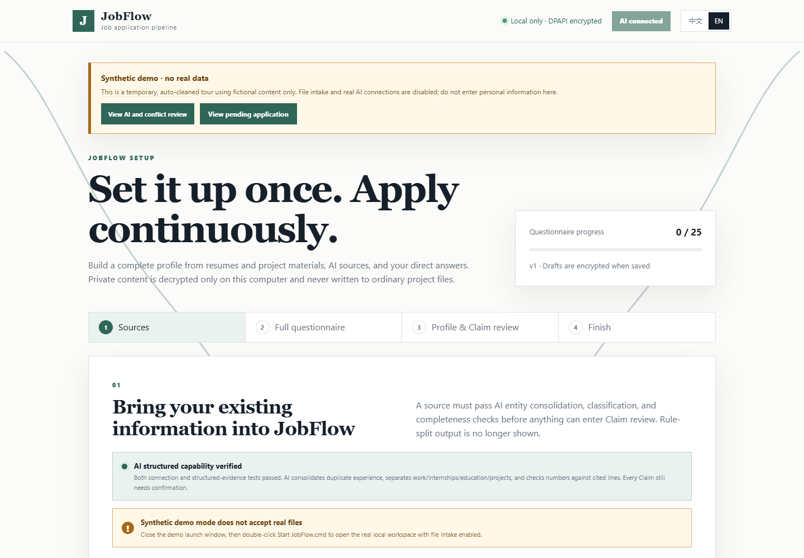

# JobFlow

JobFlow is a local-first, AI-centered job application workflow for Windows. It turns a resume, approved applicant facts, and an official job page into a reviewable application packet, then provides user-present browser assistance that stops before final submission.

> **Alpha software:** JobFlow does not claim universal ATS compatibility. Final Submit is always a trusted user action. Unknown external state is never retried automatically.

Browser Companion **0.9.2** is published on [Chrome Web Store](https://chromewebstore.google.com/detail/pgcnlkfakkacphkdojdbphccjnbbefic) and [Microsoft Edge Add-ons](https://microsoftedge.microsoft.com/addons/detail/cebejbohadiofomfiplljnpdefjeiccp) (verified October 27, 2026). The [v0.7.0 source prerelease](https://github.com/ValerianXXX/JobFlow/releases/tag/v0.7.0) remains for evaluation: signed Windows distribution and clean-Windows acceptance are not yet complete.

> **Version compatibility:** the latest stable desktop release, v0.6.0, requires Browser Companion 0.9.1 and rejects the store's 0.9.2 update. Current v0.7.0 source targets 0.9.2, but a matching signed stable desktop update is not yet available. Reinstalling the extension will not resolve this mismatch; do not bypass the version check.

See the [compatibility and recovery matrix](docs/compatibility.md) and [October 27 release verification](docs/modernization-2026-10-27.md). CI now detects version drift across Python, JavaScript, lockfiles, the extension and its UI. The source demo is available through the Development setup below while signed installation remains blocked.

The source branch includes these reviewable capabilities. They are not a new signed desktop release.

The [runtime revalidation follow-up](docs/runtime-revalidation-2026-10-30.md)
preserves a failed 1,352-test full run, repairs native staged-file validation for
deep paths, and corrects the public-English guide. Focused native execution and
documentation checks pass. The subsequent full run at `b97dbe0` completed 1,361
tests with no failures and four native-symlink skips; later changes need their own
checks. This does not establish signed-release or clean-Windows acceptance.

Documented work duration now excludes gaps, overlapping jobs and repeated Claims. Partial dates retain bounds; internship time and skill-specific or full-time requirements require separate review. New Profiles use version 3 while older Profiles remain readable; older generated tenure values need a reviewed revision before supporting a years requirement. [Duration rules, regression evidence and rollback](docs/experience-duration-2026-10-29.md) also record the six-sample Profile-hint check without claiming complete material understanding.

The [loopback rejection repair](docs/probe-rejection-2026-10-29.md) addresses a
Windows connection-abort regression, rejects duplicate pairing request lengths
and bounds rejected-body reads with one deadline. Local HTTP checks are separate
from installed-browser and clean-Windows release acceptance.

The [full-regression follow-up](docs/test-isolation-2026-10-29.md) retains an initial
local run with seven failures and two errors, explains its environment and PDF-test
isolation defects, and records the focused repairs. It does not replace the missing
full-material semantic acceptance or clean-Windows release acceptance.

The [focus-recovery follow-up](docs/busy-focus-recovery-2026-10-29.md) fixes a
hosted onboarding failure after saving and an emergency interruption settle.
Its ten frozen browser cases pass; independent-user and release acceptance
remain separate requirements.

| Capability | Available source behavior | Verification and limits |
| --- | --- | --- |
| Materials and facts | Optional PDF/image transcription, entity-linked candidates, encrypted originals and separate source/Claim review | [Source-fact review](docs/source-fact-review-2026-10-29.md) accounts for 241/282 source facts in candidates across six exposed development files. Twelve private identity/contact facts are outside the Claim channel; a later six-source check verified email hints only. Full-material acceptance remains open. |
| Omission review | Click uncited ranges, candidate citations or source notes to inspect the saved, numbered analysis text; compare original PDF/image pages separately | [Transcript review](docs/analysis-text-review-2026-10-30.md): encrypted, hash-bound snapshots survive confirmation/reopen, and changed analysis invalidates old coordinates. Old imports, segmented input, large transcripts and ChatGPT exports have explicit limits. Input coverage and citations never certify fact completeness. |
| Source constraints | Separately retained source excerpts for work constraints and missing evidence, with links to Profile questions | [Fact-preservation follow-up](docs/fact-preservation-2026-10-30.md): two new real responses recover the four preceding gaps; each represents 41/47 facts in candidates, with four more only in unconfirmed context. Exposed samples do not establish full-material acceptance. |
| Original-source review | Side-by-side original pages, source regions, zoom/fit and keyboard scrolling | [Browser acceptance](docs/pdf-regions-and-cjk-2026-10-29.md) covers actual upload/parser/render/DPAPI with a recorded model response; it is separate from live model observations. |
| Editable resume | Preserve an approved DOCX master, or create a new standard DOCX from approved PDF-source facts | [Standard-resume workflow](docs/standard-resume-2026-10-29.md); new layouts require review and renewed material/position approval. |
| Local PDF output | Default Word or explicitly selected LibreOffice with isolated conversion and document QA | [Paired output checks](docs/local-pdf-export-2026-10-29.md); unsafe two-column output remains rejected. No office software is installed automatically. |
| Application workspace and tracking | Saved job/material versions, review history and local EML evidence with reversible manual association | [Workspace verification](docs/workbench-modernization-2026-10-28.md); no authenticated mailbox connector or automatic protected-state update. |
| Hermes and local models | Existing configured Agent/local-model analysis, plus optional read-only MCP metadata tools | [Setup and boundaries](docs/visual-materials-and-status-tracking.md); cloud routes can receive supplied content. No new Agent installation is required. |

The [browser-operated acceptance review](docs/user-acceptance-2026-10-29.md)
retained pending evidence and exercised a separate synthetic application rehearsal.
It is coding-assistant simulation, not an independent user study or a live
employer submission. The [next development plan](docs/next-upgrade-plan-2026-10-29.md)
retains the missing full-material, route-specific ATS, mailbox and user acceptance.
An optional Docling parser also remains available; its earlier comparison found
no extraction-quality gain. The new `pdf_regions` option requires no new package.

The owner approved [one historical identity exception](docs/modernization-2026-10-27.md#specific-historical-identity-approval---28-october-2026)
and chose account-linked noreply commits. These decisions do not authorize
signing or publication. On October 29 the owner confirmed that trusted production
signing and an independent clean Windows machine/VM are unavailable. Installation,
upgrade, data-preservation and rollback acceptance remain blocked. Hosted checks
and older passing matrices apply only to their recorded commits; unsigned local
packages do not authorize a release.



## What JobFlow does

1. Imports resumes and supporting material into Windows DPAPI encrypted storage.
2. Connects to an existing Hermes, OpenClaw, or supported loopback model without copying model credentials into the project.
3. Uses AI to reconstruct experience entities, preserve metrics, and produce source-grounded Claim candidates.
4. Collects one reusable Candidate Profile and Answer Bank, with explicit review for sensitive or missing facts.
5. Starts from an official company career page, verifies the job and approved ATS route, and builds one application review packet.
6. After one application-specific approval, fills approved values, attaches approved materials, and advances only through verified non-final controls while the user is present.
7. Stops at final review so the user can inspect the page and personally click Submit.
8. Optionally polls only the exact public company or supported ATS job sources the user approves, for at most seven days, and places matched roles in a local candidate inbox.
9. Keeps application preparation manual and user-present: a discovered candidate does not open Apply, create an application, fill a field, upload a file, or advance a form until the user chooses it and completes the normal review gates.

## Quick start on Windows

`Install JobFlow.cmd` calls `scripts/install-jobflow-v2.ps1`, the stock-Windows, bootstrap-first installer. It does not use a system Python, create a virtual environment, or build from source. It accepts only the exact complete Windows runtime named by a signed schema-v2 manifest on JobFlow's pinned stable GitHub release. If that release is not yet available, installation stops clearly and activates nothing.

1. Download and extract the latest JobFlow source ZIP.
2. Double-click `Install JobFlow.cmd` once while connected to the internet.
3. Install **JobFlow Browser Companion** from the official Chrome Web Store or Microsoft Edge Add-ons listing selected for the detected browser, and confirm its published version matches the release notes.
4. Start JobFlow from the installed Start menu shortcut.
5. If startup fails, run the installed **Check JobFlow** shortcut and follow the first failed check.

The installer copies the application into a fixed, versioned directory under the current Windows account. Candidate data, queues, reports, and encrypted private material remain in a separate data directory, so the extracted download can be removed after installation. Running a newer installer upgrades the application without replacing that data; the Start menu also provides update verification, health check, rollback, and uninstall shortcuts.

Installed builds contain a user-initiated verifier for a fixed stable GitHub release channel. The current public signing path is intentionally disabled until a protected publisher environment can attest the complete executable runtime closure, so local QA cannot create or authorize an official signed update. When that external gate is implemented, JobFlow will accept an update only when its canonical manifest is signed by the pinned release key and its source archive passes the signed hash, size, layout, and public-content boundary. A failed post-update health check restores the previous version. Source checkouts do not self-update and never replace their working tree.

To explore without private data, run `Start JobFlow Demo.cmd`. The demo uses fictional content, disables real AI and file intake, and removes its temporary state when closed.

See the [full quick start](docs/quickstart.md) for Browser Companion setup and recovery guidance.

## AI connections

JobFlow can reuse an already configured:

- Hermes or OpenClaw Agent on Windows or WSL;
- Ollama, LM Studio, LocalAI, llama.cpp, or vLLM loopback server;
- advanced command adapter through `JOBOPS_AI_COMMAND_JSON`.

An AI connection is accepted only after a structured capability test. Agent requests use an isolated, zero-tool channel. JobFlow does not extract, return, log, or persist API keys, tokens, cookies, executable paths, or model credentials.

## Safety boundaries

- Private applicant values remain behind `secure-ref:*` references and DPAPI encryption.
- Claims require source evidence and applicant approval before external use.
- Login, CAPTCHA, MFA, account creation, credentials, legal declarations, signatures, and unknown answers stop for the user.
- The only unattended feature is explicit, expiring, read-only job discovery. Background application opening, Apply, form filling, uploads, navigation, final Submit, email, and recruiter contact are not implemented.
- `SUBMISSION_UNKNOWN` never triggers an automatic retry.
- Knowledge sources are read-only.

## Current support

| Capability | Alpha status |
|---|---|
| Windows install, health check, rollback, and bilingual local UI | Bootstrap-first entry available; activation remains fail-closed until the stable release publishes a signed schema-v2 complete Windows runtime |
| Public signed updates | Blocked until protected publisher runtime closure is attested |
| Encrypted onboarding, Candidate Profile, Answer Bank, and Claim review | Available |
| Existing Agent or loopback-model connection | Available with capability gate |
| PDF master to standard editable resume | New source preview: approved wording → DOCX → optional local Word or explicitly selected LibreOffice PDF preview → user-approved new revision; original styling is not reconstructed |
| Application workspace and original PDF/image comparison | Available in this source preview; missing or modified snapshots are shown explicitly |
| Local EML status inbox | Explicit file import, encrypted evidence, manual association and undo; no mailbox connection or execution-state changes |
| Read-only MCP for Hermes and compatible clients | Optional extra; three redacted tools, actual stdio client checks with synthetic data |
| Visible official-company job discovery and verified Apply routing | Available with user authorization |
| Expiring read-only background discovery to a local candidate inbox | Available for exact approved HTTPS sources; maximum seven-day authorization |
| User-present company, Greenhouse, Lever, Workday, Ashby, and SmartRecruiters assistance | Bound routes only; live compatibility varies |
| Approved field fill and material attachment | Available per approved application |
| User-present local queue cadence, pause, and manual run | Available; every run requires a user click |
| Redacted diagnostics and optional local fixed-code incident history | Available; manual download only, no automatic transmission |
| Unattended application processing or final submission | Not implemented; final Submit is permanently user-only |

Synthetic and saved-page tests are engineering evidence, not proof that every live ATS page is compatible.

## Development

```powershell
py -3.11 -m venv .venv
.\.venv\Scripts\python.exe -m pip install -e ".[build,mcp,document]"
npm ci --ignore-scripts
.\.venv\Scripts\python.exe -m pip check
.\.venv\Scripts\python.exe -I -m jobops.cli --version
.\.venv\Scripts\python.exe -m jobops.compatibility
.\.venv\Scripts\python.exe -m jobops.cli demo
.\.venv\Scripts\python.exe -m unittest discover -s tests
```

Python 3.11-3.13 is supported for source development. Install the locked Node dependencies before full Python discovery: that suite also verifies their exact tree. Each worktree needs its own populated `.venv` and `node_modules`; setting `PYTHONPATH` or borrowing another checkout's interpreter does not prepare the isolated launcher tests. `npx playwright install chromium` and `npm run test:e2e` run the browser checks. Release scanning additionally requires the explicitly selected, trusted Git described in [the release checklist](docs/release-checklist.md). Source setup is not a signed installation and does not authorize production release.

`mcp` and `document` are optional runtime extras, included above to run their integration tests. Ordinary use can install `.[build]`. See [configuration and reproduction](docs/workbench-modernization-2026-10-28.md#run-and-configure) for MCP, Docling, and the synthetic comparison.

The project is intentionally Windows-first because secure applicant storage uses DPAPI. Runtime state, databases, review packets, encrypted private files, and local release reports are excluded from the public repository.

## Documentation

- [Quick start](docs/quickstart.md)
- [Support](https://valerianxxx.github.io/JobFlow/support.html)
- [Browser Companion privacy](PRIVACY.md)
- [Architecture](docs/architecture.md)
- [Application workspace, source references, evaluation and rollback](docs/workbench-modernization-2026-10-28.md)
- [User acceptance review, actual capabilities and remaining gaps](docs/user-acceptance-2026-10-29.md)
- [Roadmap](docs/roadmap.md)
- [Next upgrade plan and verified reference implementations](docs/next-upgrade-plan-2026-10-29.md)
- [Release checklist](docs/release-checklist.md)
- [Security policy](SECURITY.md)
- [Contributing](CONTRIBUTING.md)
- [Changelog](CHANGELOG.md)

When reporting a problem, use **Privacy-safe incident history and support → Download diagnostics** in the local UI. The JSON contains only versions, states, counts, safety boundaries, and validated fixed error codes. Optional incident capture is off by default and keeps at most 32 local records when explicitly enabled. It does not include resume text, answers, Claim text, error messages, stack traces, URLs, local paths, credentials, tokens, or secure references, and JobFlow never transmits it automatically.

## NeedRadar portfolio relationship

JobFlow applies evidence gates, private-data controls, explicit approvals, and user-only final actions within the [NeedRadar evidence-to-execution ecosystem](https://github.com/ValerianXXX/needradar/blob/main/docs/ECOSYSTEM.md).

The relationship is pattern-level and metadata-only. JobFlow has no NeedRadar runtime dependency, and private profiles, resumes, application state, secure references, and external-action records never enter NeedRadar. Product issues cannot independently validate general market demand. See [`needradar-project.json`](needradar-project.json).

## License

[MIT](LICENSE)
