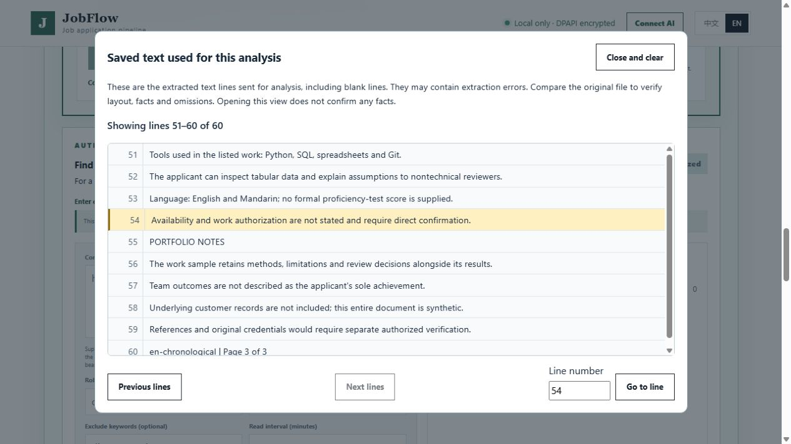
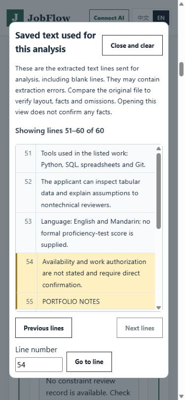

# Saved analysis-text review — October 30, 2026

The source-review panel previously listed uncited line ranges without a numbered
text viewer. PDF/image originals could be compared visually, but their layout did
not identify the exact text coordinates used for analysis. Re-extracting a file
later can change its line order, so it is not a substitute for a saved snapshot.

## Behavior and privacy

New eligible imports retain the normalized input actually passed to document
analysis inside the existing encrypted onboarding state, alongside the retained
source metadata. The host records source and text SHA-256 hashes. Bootstrap and
ordinary project indexes omit the snapshot text; the authenticated, origin-checked
local `source-review-text` endpoint is the only new read surface. Responses use
`Cache-Control: no-store`. Reading verifies both the current encrypted original
and the saved transcript, without another parser or model call.

The bilingual viewer links from uncited ranges, candidate citations and source
context notes. It preserves blank lines, highlights the requested coordinates,
supports earlier/later windows and a direct line number, and retains keyboard
navigation. HTML-like source content stays literal text. Closing clears the
rendered content and ignores a late response. No browser storage is introduced.
The complete snapshot is never sent in ordinary bootstrap. Confirming the source
and reopening the service preserve the snapshot; discarding or deleting its
source revokes access. A pending replacement analysis takes precedence, so a
stale page cannot silently read new coordinates. Discarding that replacement
restores access to the saved source's earlier snapshot.

These are extracted lines, not original pixels or verified facts. The existing
original PDF/image view remains separate; DOCX and text originals can be opened
alongside review. Citation coverage, viewing, pagination and full text retention
do not establish semantic recall. Claims remain unselected, Profile constraints
remain unchanged and all external-approval gates remain in place.

## Bounds and compatibility

- Snapshots are limited to 2,000,000 Unicode characters. Larger input can still
  follow its existing analysis flow, but its text viewer is unavailable.
- Each read returns at most 100 whole lines and 32,768 Unicode characters. A
  single line exceeding that limit is rejected rather than silently truncated.
- AI-segmented oversize lines do not have stable original coordinates; the viewer
  is unavailable for these inputs. ChatGPT exports never retain this transcript.
- Older saved sources have no snapshot. Check the original or explicitly run
  the existing re-analysis action; opening review does not run or charge for AI.
- No dependency, provider, new setting, database migration or production action
  is required. Existing DPAPI access and normal source-analysis setup apply.

## Validation

Nine lifecycle/privacy contracts were frozen in `4277122` before implementation.
They produced one failing HTTP assertion and 18 missing-feature errors/subtest
errors across nine methods. All nine pass unchanged after implementation. Four
additional limits/asset contracts pass: **13 tests in 13.424 seconds**. Coverage
includes exact Unicode/blank lines, private bootstrap/project exclusion,
confirmation/reopen, old-coordinate invalidation, replacement discard, source
and transcript tampering, unauthorized origins/sessions, deletion and character
limits. These use a memory secure-store contract double; actual DPAPI evidence
is separately described below. Test preparation initially used unsupported
fixture source names and imported a helper test class into discovery; those
harness errors were corrected before freezing, not counted as product defects.

Existing source-context tests pass **29/29**. A related **96-test** run passed 94
and exposed two assertions tied to the prior asset-cache revision. Both strict
assertions were updated to the actual new revision and passed in a focused rerun
(0.009 seconds). The initial JavaScript run likewise stopped at the old cache
revision assertion. After synchronizing both script and stylesheet expectations,
all **15 JavaScript/Edge suites pass**. A subsequent focused transcript run also
passes after making previous-window navigation available when opening a gap in
the middle of a source. Assertions about security, facts and approval were not
removed or weakened.

The new eight-group browser contract suite covers English/Chinese, 1280/390-pixel
viewports, keyboard activation, gap/candidate/context navigation, pagination,
literal HTML, blank lines, stale analysis, late responses after close, retained
sources and unchanged selection. Its backend is a contract double, with zero
external requests. Full Python discovery on the new source commit is a separate
milestone check; do not substitute the earlier `ad37cff` full pass for this code.

## Actual loopback HTTP and Windows DPAPI review

The coding assistant used `tests/source_coverage_ui_server.py --stdio-control`:
the original three-page synthetic English PDF and a pinned recorded model
response, actual PDF text extraction, local HTTP and Windows DPAPI. No new model
request was made. The material has 60 analyzed lines, including 19 uncited lines
in that historical response. The browser followed the 54–55 gap to the original
statement that availability and work authorization require direct confirmation.

Desktop Chinese and mobile English review worked. At a requested 390×844
viewport, the document scroll width was 375 and the dialog's client/scroll widths
were both 335. No candidates were selected. Previous-window and direct-line
navigation worked; confirming the source with no Claims and refreshing retained
the same 60-line snapshot. Closing cleared the dialog. The owned browser tab and
server were closed, the viewport override reset, and the fixture reported removal
of its temporary state. This is assistant-operated synthetic workflow evidence,
not independent human acceptance, a new model comparison or an employer action.





## Reproduction and rollout

Use the existing development environment with its declared optional test extras:

```powershell
python -m unittest discover -s tests -p 'test_analysis_text_review*.py' -v
node tests/onboarding_analysis_text_e2e.cjs
node scripts/run-javascript-e2e.cjs
python tests/source_coverage_ui_server.py --stdio-control
```

The final command prints a synthetic loopback URL; send `STOP` to its stdin when
finished. It accepts no applicant path. Existing `audit` and `locate --write-state`
also passed in a separately isolated synthetic project with an unchanged
knowledge marker. Initial safe-start setup failures are retained locally: the
source CLI resolves its package project rather than the process working
directory, and the copied fixture initially lacked the Companion store config.
No real knowledge source was read or modified to repair those fixtures.

For rollout, review the stacked draft and run its own complete checks before
merging. Revert this feature through an ordinary reviewed commit for rollback;
preserve encrypted state before any downgrade. Existing source records still
work, while older code does not display the optional snapshot fields. Do not
strip newer Profile versions or erase observation history to downgrade.

Full 36-material/holdout semantic acceptance, complete Profile handling,
independent users, live ATS/mailbox workflows, trusted production signing and an
independent clean Windows lifecycle remain open. This change does not improve or
remeasure model accuracy, latency or billed cost; review-effort savings are not
yet measured. The earlier closed model-budget journals remain untouched.
