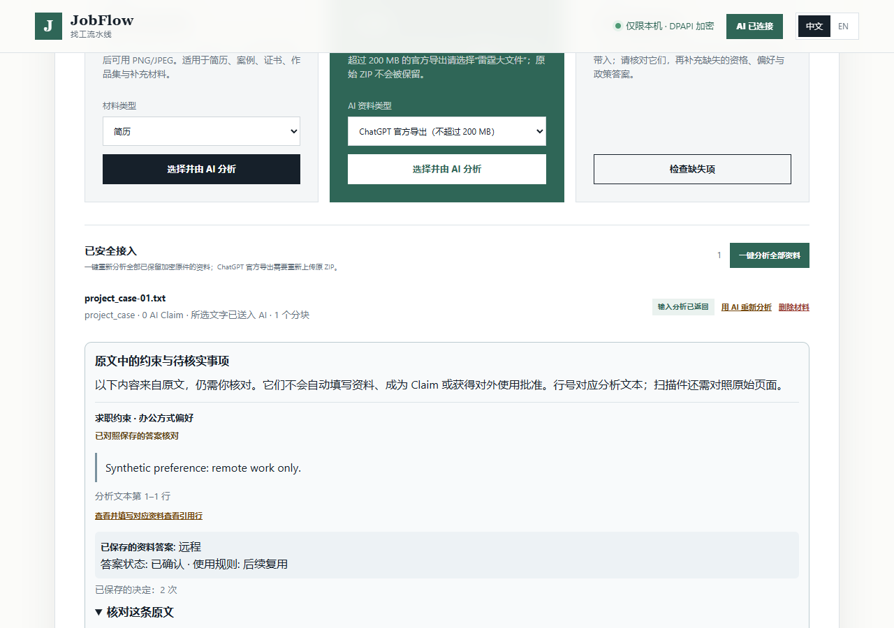
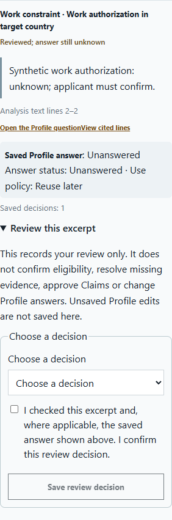

# Private review of source constraints and missing evidence

Verified October 30, 2026. Source development on the template-pilot branch;
not a signed release, production deployment or independent user acceptance.

## Problem and behavior

Previously every retained context excerpt permanently said **Needs review**.
A link opened the relevant Profile question, but there was no durable record
of whether someone compared its saved answer with the excerpt, needed more
evidence, or set the issue aside. Answer changes could not invalidate a review.

The new `context_decisions` module stores these decisions independently of
answers, Claims, Profile approval and external-use approval. The new UI module
only decorates confirmed, retained source notes; pending analysis previews
remain read-only. The original quote, its analysis-line citation and the
original-file review remain available.

1. Confirm a source, then open **Review this excerpt** under its context note.
2. A constraint shows the **saved** Profile answer, its status and use policy.
   Review decisions never copy the source text into an answer. Unsaved Profile
   edits, including drafts carried across language switches, are not displayed
   as the saved answer and are not cleared by saving a context decision.
3. Choose **Compared with the saved answer**, **Needs follow-up**, **Set aside
   with a reason**, or **Reopen for review**. Evidence gaps have no Profile
   comparison option. Follow-up and dismissal require a structured reason;
   all decisions require an explicit checkbox confirmation.
4. An unknown answer is displayed as **Reviewed; answer still unknown**. This
   does not confirm work authorization, eligibility, the underlying fact, or
   completion of an evidence request. A dismissal is a user decision, not proof
   that the source is wrong. These decisions do not increase fact recall.

## Integrity and lifecycle

- Decisions bind source/file and analysis-text hashes, the exact note/range,
  confirmed source-analysis generation and Profile revision. Saving a Profile
  comparison additionally binds the saved value, status, source, use policy and
  an answer revision. Hashes do not replace re-reading the retained source and
  checking the quoted lines before saving.
- The encrypted-state write boundary tracks semantic answer changes from every
  answer writer. Changing an answer and then restoring it does not resurrect
  its old review. A timestamp-only/no-op save leaves the review valid.
- Pending re-analysis disables review controls. Discarding it restores the old
  review; confirming it invalidates the old generation, even if its text is
  identical. Changed note identities start pending while prior decisions remain
  in the private history. Completed onboarding requires an editable revision.
- Concurrent/stale source, answer or decision hashes are rejected. Replaying
  the exact last request is idempotent; an arbitrary stale ID is not a replay.
  Failure to persist cannot promote the status. Corrupt history fails closed
  with a recovery error, rather than silently resetting it.
- Up to 4,096 events are retained in the encrypted onboarding state. Each event
  stores bounded identifiers, hashes, decision, reason, previous-event ID and
  time, not another copy of the source quote or answer. Reopening preserves
  history. Explicit source deletion removes only that source's private events.
  At capacity, saving fails explicitly; records are never silently evicted.
- The existing loopback session and Origin checks protect the new POST route.
  Its response contains review metadata, with `answers_changed: false` and
  `approved_for_external: false`. The redacted project index does not gain
  plaintext context, answers or decision history. There is no new cloud route,
  model dependency, mailbox access, scheduler or final-submit permission.

## Verification and failures retained

Runtime implementation: `85ff7cfb088bdbdbd2283a0d51b93f1ea8909491`.
Corrected pre-implementation contract revision: `ec04318`; original test
addition: `31f3c51`. Full logs stay local under `reports/`; the public
[verification receipt](../evaluations/2026-10-30/context-review-v1.json) records
their hashes and distinguishes test-fixture repairs from product changes.

| Check | Observation |
| --- | --- |
| Existing source-context baseline | 29 tests passed in 6.290 seconds before the change. |
| Ten new frozen contracts | Initially all errored; two errors were caused by the fixture using a nonexistent answer status. Correcting it to the existing `CONFIRMED` contract left all ten failing on the missing implementation. No expected behavior was removed. |
| First implementation | All ten contracts passed in 15.233 seconds. |
| Additional rejection checks | Twelve tests passed in 18.716 seconds, including malformed history, unrelated replay IDs, changed retained bytes and a forged but rehashed quote. |
| Related Python checks | 100 of 102 passed initially; two expected the old UI cache version. Their exact expected version was updated with the real asset revision, retaining all other assertions. Both then passed in 0.008 seconds. |
| Browser workflow | Actual loopback HTTP and Windows DPAPI, fixed synthetic extraction response: saved-answer binding, unknown retained, unsaved draft/locale preservation, invalidation, mandatory reasons, reopen, pending analysis, discard, reload, session/Origin rejection, Chinese/English and 1280/390-pixel widths passed. No external requests or page errors. |
| Independent users / semantic accuracy | Not measured by this change. Browser operations were coding-assistant simulation. |
| Full JavaScript regression | All 16 suites passed at runtime revision `85ff7cf`. The later test-only screenshot adjustment waits for language saving and captures the complete card below the sticky header; its workflow also passed. |
| Full Python regression | Running at runtime revision `85ff7cf`; no pass is claimed. See the receipt/PR for the latest result. |
| Packaging | An unsigned wheel built successfully; all seven changed Python/UI files match source bytes. This is packaging validation, not signing or installation acceptance. |

Interactive browser inspection found a missing local static-asset route and an
unclear select accessible name; both were fixed before the passing workflow.
Four browser-harness attempts also retained their failures: an incorrect old
selector, an incorrect expected English translation, a request that still
included a valid session token in its URL, and a disabled-fieldset assertion
instead of the effective child control. Those were harness corrections; the
session-rejection expectation, mandatory reason and disabled-control behavior
were retained.

The fixture creates its own isolated project and DPAPI store, accepts no real
applicant path, and confirms temporary-state removal on exit. A separate
interactive session also verified unknown and follow-up behavior. No live model
requests were made. Billed cost, model quality and real human review time were
not measured; this change claims no improvement in those metrics. Closed
evaluation protocols, responses and consumed request budgets remain unchanged.

Actual synthetic browser captures (not customer data or independent participants):





## Run, configuration and rollout

Use the existing per-worktree development setup in the README, including its
own populated `.venv` and the unchanged npm lockfile. No new configuration or
dependency is required. With those prerequisites:

```powershell
.\.venv\Scripts\python.exe -m unittest discover -s tests -p test_context_decisions.py -v
node tests/context_review_ui_e2e.cjs
node scripts/run-javascript-e2e.cjs
.\.venv\Scripts\python.exe -m unittest discover -s tests -v
```

For manual inspection, run `python tests/source_context_ui_server.py
--stdio-control` in an interactive terminal and open its printed loopback URL;
send `STOP` on stdin to close the server and remove its own synthetic state.
The browser script launches and closes this fixture automatically. Its screenshots
and result JSON are saved under `reports/context-review-ui/`.

The local safe-start audit passed with zero external actions. Real Knowledge
discovery returned `KNOWLEDGE_ROOT_NOT_FOUND`; this remains a real integration
limit, not a successful Knowledge check. Synthetic tests did not need or read a
real Knowledge repository.

There is no database or production migration. Existing encrypted states default
to no decisions; optional counters/history are added only as state is saved.
Review the stacked draft and its complete checks before merging. For rollback,
stop the local service, preserve the encrypted workspace, and use a normal
reviewed revert or a matching pre-upgrade encrypted backup. An older build cannot
interpret these new decisions or maintain their invalidation counters; do not
treat them as valid after downgrading and later upgrading without fresh review.
Never erase history or strip Profile versions to make a downgrade appear valid.

The full 36-material semantic goal, undiscovered omissions, route-specific ATS
acceptance, mailbox authorization, independent user work, trusted signing and
independent clean-Windows install/upgrade/data-retention/rollback remain open.
This feature improves the review workflow; it does not establish that JobFlow
has reached the overall product goal.
