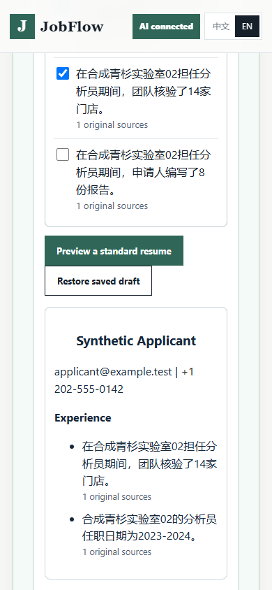

# Empty-profile verification through the first resume draft

Observed November 1, 2026. Product runtime `8df8d155fe438937f8c856590a3fd7b016f4764a`,
parent delivery `c8445a910f30d5027cee884dd220231d54cb172e` (draft #42).
This follow-up changes verification and documentation, not product runtime,
dependencies, approvals, UI protocol or release policy.

## Continuous browser path

The [fixed task card](../evaluations/2026-11-01/first-use/task-card.json) supplies
a fictional applicant and the existing synthetic two-column Chinese PDF. The
workspace starts with zero sources, zero Claims and no completed Profile.
Windows DPAPI, loopback HTTP, parsing, persistence, the UI and DOCX generation
are real. The model response is an existing pinned replay, not fresh inference.
The harness does not inject source approval, answers or success state.

| Action through the normal UI | Observation |
| --- | --- |
| Upload and inspect original PDF | Five initially unselected candidates; original page available |
| Explicitly retain candidates and reload | One saved source, five pending Claims, incomplete Profile |
| Fill and save the fictional task card | All 25 required answers resolved; all 40 required/optional fields exercised |
| Attempt completion before Profile review | HTTP 400 `PROFILE_REVIEW_REQUIRED`; state remains in progress |
| Confirm each Claim and Profile, then finish | Existing onboarding completion reached through the UI |
| Explicitly approve material use | Standard-resume selection becomes available |
| Select two of five facts and download | Two exact approved statements in the new DOCX; three remain unselected and saved |
| Reload and restore | Same two-fact selection; adoption confirmation remains unchecked |
| Close the owned fixture | Clean process exit and temporary state removed; zero external requests/actions |

The [recorded run](../evaluations/2026-11-01/first-use/profile-to-draft.json)
preserves step timestamps and the generated document hash. These are automated
observations, not measured independent-user effort. The first harness attempt
omitted navigation to the question panel and timed out on a hidden control; its
[failed record](../evaluations/2026-11-01/first-use/initial-failed.json) is retained.
Corrected navigation used the real panel controls and the normal completion gate.
No application, final submission or mailbox activity was seeded or executed.



The downloaded DOCX in this continuous path was **not** converted to PDF,
adopted as a master, taken through a new revision or used to prepare an application.
Separate [native rendering and adoption checks](standard-resume-selection-2026-11-01.md)
use other synthetic fixtures and must not be stitched into a single completed
business journey. The completed-Profile UI-language reset also remains open.

## Discovery test correction

The full local regression in a directory containing `resume` exposed a false
positive: a safety assertion searched the entire serialized command, including
the legitimate configured script path, for applicant-data words. A focused
reproduction failed the original assertion; product code was not implicated.

The corrected test requires the entire argument list to match the configured
executable, exact script path, fixed flags and allowed action. Its original
forbidden-data checks remain on the non-path arguments. A path with a changed
value still fails the exact comparison. Added checks cover nine combinations of
plain, spaced/keyword and Chinese directory names with Register/Status/Remove;
six added-data/altered-path/action mutations must fail; four unknown actions must
never reach the process runner. The mock runner does not register an OS task.

The two related discovery modules passed **37 tests in 5.464 seconds**. The
[before](../evaluations/2026-11-01/first-use/discovery-before.txt) and
[after](../evaluations/2026-11-01/first-use/discovery-after.txt) logs retain their
different outcomes. The original full run continues against frozen source/tests
and retains its own failure; this focused pass does not relabel it as all green.
Exact-delivery hosted results are reported separately in the draft PR.

The first public-boundary scan rejected a command-mutation fixture's synthetic
email spelling. The public delivery uses the already allowed reserved test domain
and again passes the same 37 tests (5.581 seconds), with no scanner-policy change.
The initial local commit remains unpublished and intact; the delivery starts at
the clean parent without rewriting history. Escaped workstation paths in the
failure log are redacted, with the original raw log and hashes retained locally.
Because the local history scan includes every branch in a shared repository,
the public delivery uses a separate single-branch clone of the published parent.
All original repositories/branches remain intact; the full public scan remains enabled.
Earlier receipts identify their actual unpublished test checkout; their product
tree is identical to the public runtime above. The
[delivery supplement](../evaluations/2026-11-01/first-use/delivery-verification.json)
records the corrected test hash and fresh result without replacing older outcomes.

## Reproduce and limits

Use the README development environment with declared Python extras, the pinned
JavaScript dependencies and an existing local Microsoft Edge installation.
Run from a Git checkout with the recorded reference commit available. The runner
records the actual checkout/product tree and whether its runtime matches that
reference; it never labels a later runtime as the historical version.

```powershell
python -m unittest discover -s tests -p 'test_authorized_discovery*.py'
node evaluations/2026-11-01/first-use/verify-browser.cjs
```

The browser runner starts the existing empty synthetic fixture, accepts only
its pinned inputs, blocks non-loopback browser requests and closes/removes its
owned state. Each invocation writes a new ignored `reports/empty-profile-replay`
directory. `JOBFLOW_TEST_PYTHON` can select an already prepared interpreter;
`JOBFLOW_OBSERVATION_ID` selects a new explicit report directory. Existing results
are never overwritten. It does not connect to an Agent or download a model.

The [verification receipt](../evaluations/2026-11-01/first-use/verification.json)
binds source/test/artifact versions and preserves the original pending observation.
The [terminal supplement](../evaluations/2026-11-01/first-use/terminal-verification.json)
records the published runner passing, its actual checkout/product tree, and
unchanged source. One failed navigation attempt and three successful repetitions
all use the **same** task card; they are not four independent applicants or model
samples. The initial published harness is archived under its original hash.
This provides additional workflow evidence for existing behavior, not new AI
recall, relevance, speed or cost improvement. Fresh model calls are zero; total
workstation/subscription cost is unknown. Independent applicants, a continuous
application-preparation journey, real ATS/mailbox checks, trusted signing and
independent clean-Windows acceptance remain unverified or blocked.

There is no runtime or data migration in this follow-up. A normal reviewed revert
can remove these verification/documentation changes without touching applicant
data; the parent selection feature's separate downgrade constraints still apply.
