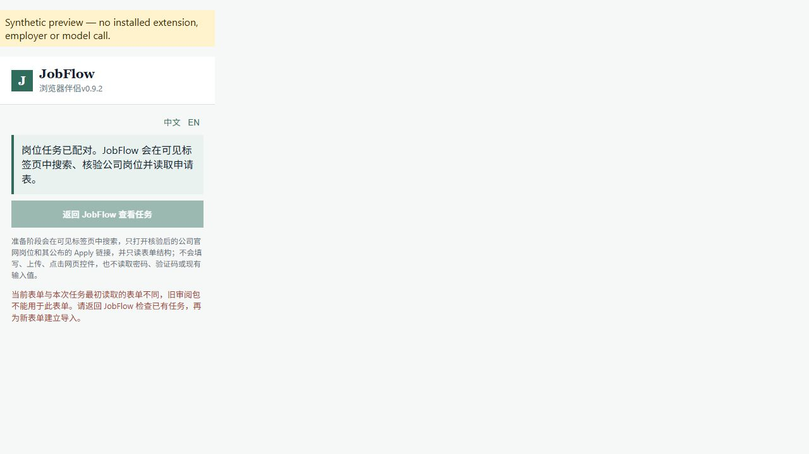

# Guided preparation ownership and recovery — 2026-10-31

Closing JobFlow could close browser/AI resources while an already accepted
background preparation still wrote its local result. A thread that failed to
start left a permanently pending entry. Reusing the same import token with a
different form could return the earlier packet. These defects were reproduced
against PR #33's delivery at `295033772538453df0036d6479e00c216746d1f9`.

The follow-up owns these workers, binds cached results to the input snapshot,
and gives the Companion a safe recovery path. Runtime commit:
`2f60e9537a2eb1017998517f0376e44526cd22b6`.
It adds no model, dependency, account access, product configuration or database
migration. Existing company/ATS, Claim, approval and final-user-submit boundaries
remain in the original preparation pipeline.

## What changed

`GuidedPreparationJobs` holds transient job metadata, a hash of the captured
input and owned non-daemon threads. The actual preparation still calls
`capture_guided_application_form` and its existing validation/persistence path.
No raw input or progress is newly persisted; the snapshot remains in memory for
the existing operation and is released when the worker exits.

- Stop accepting preparation starts when close begins, then join accepted
  workers outside the service lock before closing browser/AI resources.
- Keep worker ownership independently of pollable progress. Discarding progress
  does not detach a live writer; late completion cannot resurrect discarded
  progress. Reject worker self-close before taking the completion lock.
- If launch fails before a worker starts, remove the pending record and allow a
  new explicit request. If launch reports an error after the worker started,
  retain its ownership and progress, and report an uncertain launch.
- Exact replay remains idempotent during preparation and after completion.
  Recheck after waiting for the service lock so concurrent requests observe the
  same result. Changed input is rejected for a pending or successful job; a
  previous packet cannot stand in for the new form. Expiry still applies.
- The Companion polls an uncertain launch through the existing status endpoint,
  without another capture POST. Definite start failure stays an explicit retry;
  input mismatch stays blocked. The popup retains Chinese/English explanations
  on reopening and disables its preparation button for mismatched input or a
  closing service. Polling is not an automatic retry of preparation.
- Repeated/concurrent close calls share completion and clean dependencies once.
  Cleanup failures remain visible after drainage and are not silently retried.

## Fixed comparison and evidence

| Check | Before repair | After repair | Scope |
|---|---|---|---|
| 11 frozen lifecycle contracts, `dbeea07` | 1 pass, 8 failures, 2 errors; 3.253 s | 11 pass; 3.062 s | Real service/locks/SQLite and one actual loopback route; controlled synthetic preparation |
| 7 additional concurrency/fault contracts, `8753107` | Combined 18: 17 pass, 1 failure; 5.220 s | 18 pass; 5.175 s | Concurrent replay, expiry, discard, close races, cleanup failures |
| Existing background preparation contract | Existing scenario had treated a changed URL as an exact replay | Final runtime: pass; 0.235 s | Preserve exact replay and add explicit changed-URL rejection, retaining the one-operation assertion |
| Companion uncertain-start contract, `8753107` | Failed: returned BLOCKED instead of querying the owned job | Pass: one capture POST, one status query, no resubmission | Actual worker source in a synthetic Chrome API harness |
| Popup recovery contract, `4d337ac` | Failed: input-change explanation absent after refresh | Four bilingual recovery states pass | Actual popup source in its existing synthetic DOM harness |

The frozen assertions were retained. The existing changed-URL assertion was
strengthened to distinguish replay from a different form; it was not removed to
make the suite pass. The comparison is about lifecycle correctness, not model
quality, real applicant completion, speed improvement or cost savings.

The [verification receipt](../evaluations/2026-10-31/guided-preparation/verification.json)
records source/log hashes, additional checks and the observed full-suite state.
At this runtime all **17 JavaScript/browser suites** finished with exit 0. The
five public-documentation checks, 12/12 redacted health checks, source version
consistency, public tree/approved-identity gate, wheel build and source extension
package build also pass. The extension ZIP is an unuploaded verification artifact
under the existing manifest version, not a new store release.
Full local and hosted checks are distinct from the targeted contracts. A running
check is not a pass, and an earlier branch's result does not validate this commit.

The new full Python regression was started at the runtime above. The base branch's
1,503-test local run remains failed because its isolated checkout initially lacked
the required JavaScript dependency tree. That tree was restored and 16 focused
toolchain checks passed; that recheck does not turn the original run green.
PR #32's hosted Python 3.12 run also remains failed on a 30-second Node trust-probe
timeout. PR #33's new probe diagnostics are still needed to establish its cause.

## Actual browser observation and limits

The actual `popup.html`, CSS and JavaScript were opened in the in-app browser
through the explicit synthetic preview below. No installed extension, employer,
mailbox, model or applicant was used. This is agent-operated browser observation,
not independent-person or live-site acceptance.

Observed: preparation disables repeat generation; Chinese/English switching
works; reopening the changed-form state retains its explanation and disabled
return-to-JobFlow button; definite failure leaves an explicit retry entry; ready
state directs the user to local review. A click in the synthetic failure preview
returned `SYNTHETIC_PREVIEW_ONLY`, not a real operation or permission grant.
The before screenshot exposed the missing error explanation, which was then
covered by the frozen popup contract and corrected.



No complete installed-Companion-to-desktop uncertain-launch scenario has been
executed against a real employer. Store version 0.9.2 is not a claim that these
unreleased source changes are already distributed. A new reviewed extension
version and compatibility recheck are required before any store upload.

## Reproduce

Use the existing Development setup in README, the project's Python 3.11–3.13
interpreter and pinned JavaScript dependencies. For native release tests, retain
the authenticated Node prerequisite described in the
[Node-selection record](release-node-selection-2026-10-31.md). Do not change the
global runtime or signer policy to satisfy a fixture.

```powershell
python -m unittest discover -s tests -p test_guided_preparation_lifecycle.py -v
node tests/browser_companion_guided_autopilot_e2e.cjs
node tests/browser_companion_popup_e2e.cjs
python tests/guided_preparation_popup_preview.py
```

Open the printed loopback URL; add `?scenario=unconfirmed`, `ready`, `failed` or
`changed`. The preview explicitly labels its synthetic API responses and never
installs an extension, grants a permission or starts an application. Press Enter
in its terminal to close it. Product usage remains the normal paired Companion
flow; there are no new configuration switches.

## Remaining work and rollback

This is a graceful completion barrier, not forced thread termination, a shutdown
deadline, crash/power-loss recovery or a new mid-preparation cancel mechanism.
It waits for the existing local operation to finish; a stuck dependency can keep
shutdown waiting. Progress is ephemeral, so a restarted process cannot recover a
pending thread or justify automatic resubmission. After an uncertain shutdown,
inspect persisted applications and existing audit state before another import.

The complete 36-material acceptance target, truthful Claim recall/error targets,
live provider validation, independent first-use tests, trusted production signing
and clean-Windows install/upgrade/data-retention/rollback remain open. This stage
contains no new model call or measured AI improvement. The separately requested
additional material quota remains pending; the closed prior campaign is intact.

Review the branch against its PR #33 base before integration. For source rollback,
close the local server normally and wait for owned work to finish, preserve its
existing encrypted data and audit, then use a reviewed revert of this follow-up
to restore base `2950337`. No database downgrade or data deletion is needed. The
old preparation lifecycle/input-identity defects return on rollback; do not use
forced termination as a recovery procedure. Keep the matching desktop/Companion
source pair. No release, store upload, production deployment or default-branch
merge is performed or approved by this milestone.
