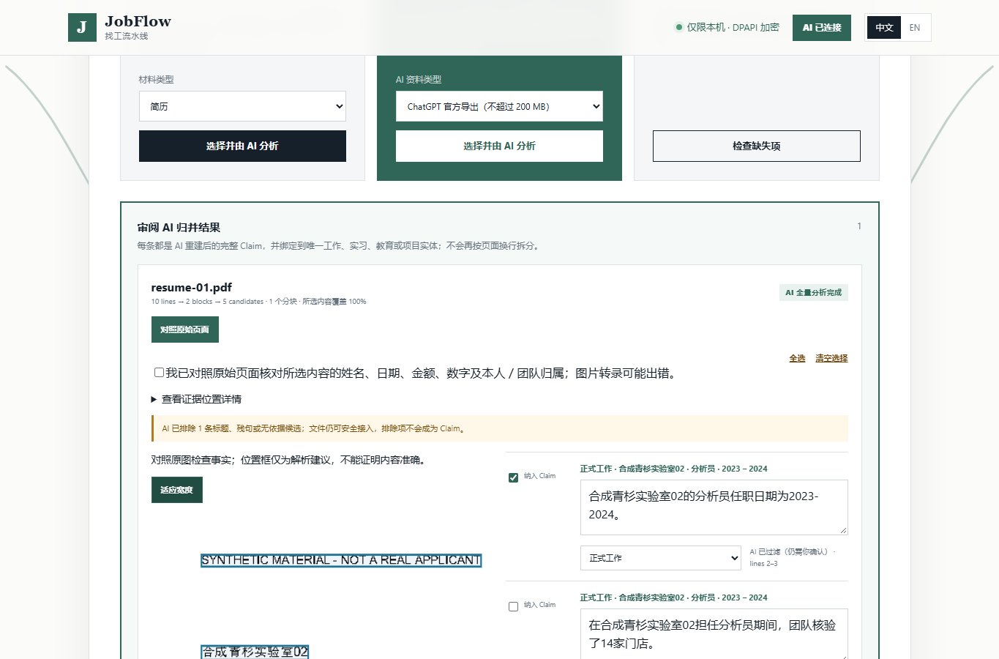

# Local PDF regions and Chinese Claim validation — October 29, 2026

This milestone repairs a Chinese validator defect and adds an optional local
PDF geometry reader. It does not complete JobFlow's material-accuracy,
live-application or signed-distribution acceptance. A real scanned-Chinese
observation failed factual accuracy; that failure is retained below.

## Implementation and evidence boundaries

The original uppercase-heading gate collected all alphabetic characters and
compared them with `upper()`. Chinese characters have no case, so complete
Chinese statements with enough characters were rejected. Count only characters
with distinct lowercase/uppercase forms. Three of six targeted regressions
failed before this change; all six pass afterward. The unchanged minimum length,
sentence ending, number grounding, source overlap, entity/category and human
approval requirements still apply. A short Latin acronym does not turn a Chinese
sentence into a heading; long uppercase Latin headings still fail.

`JOBFLOW_DOCUMENT_PARSER=pdf_regions` runs the existing pdfplumber dependency in
a bounded subprocess. Repeated gutters and overlapping column bands propose
reading order, and original word geometry supplies page/line boxes. The shared
parent validates every original page independently and binds the result to its
original hash. Ruled pages retain row order. Scans, rotated text, missing text
pages, invalid geometry and limits fail explicitly, without a partial document
or automatic cloud fallback. The child loads this checkout's package rather
than an accidentally inherited editable sibling.

This is geometry, not semantic table understanding or OCR. A left-aligned footer
can remain in the left column before the right column. Decorative rules may
conservatively prevent reordering; unruled tables remain ambiguous. Original
review remains mandatory, all candidates start unselected, and Claim approval
is a separate operation. The default extractor and exported-document QA remain
unchanged: unsafe two-column *output* still fails its reading-order check.

The UI now collapses coordinate details and supports original-page zoom/fit
with a keyboard-scrollable viewport. The displayed boxes scale with the image.
Local UI protocol 40 prevents mixing cached earlier assets with this backend;
the Companion version and protocol do not change.

## Frozen offline comparison

The [corpus](../tests/fixtures/material-layout-probes-v1/README.md) contains 36
short probes, with 12 each in English, Chinese and mixed language. It is not the
planned 36 complete resumes/portfolios. Its 24/12 split was fixed before the
final comparison, but related templates cross partitions; results do not estimate
independent-document generalization. All original rendered pages were inspected
in this task; source/render hashes are retained in the review receipt.

| Measure | Existing extraction | Optional PDF regions |
| --- | ---: | ---: |
| Development readable sources | 16/24 | 16/24 |
| Development designated verbatim facts | 64/96 | 64/96 |
| Development complete entity contexts | 20/48 | 28/48 |
| Held-out readable sources | 8/12 | 8/12 |
| Held-out designated verbatim facts | 32/48 | 32/48 |
| Held-out complete entity contexts | 10/24 | 14/24 |

Across only the 24 readable sources, complete entity contexts are 30/48 versus
42/48; the remaining cases are ruled tables. Across all 36 probes the denominator
is 72, not 48. Twelve image-only sources remain blocked in both text paths.
Verbatim retention does not establish semantic or Claim accuracy.

Aggregate extraction time was 532 versus 6,484 ms for development and 344 versus
3,281 ms for held-out. The optional worker is slower here. These single local
observations are not a latency distribution. Both offline paths made zero model
calls; downstream model cost is a different measurement.

Receipts: [development](../evaluations/2026-10-29/layout-development.json),
[held-out](../evaluations/2026-10-29/layout-held-out.json).

## Live observations, including the failed scan

Both experiments used the existing `gpt-5.6-sol` / `openai-codex` route through
Hermes `afe53708ee7400919ae3e17a6dde9b02629e5c87`, with zero tool calls and no
account/provider changes. Inputs are fixed synthetic files. Tokens, provider
internal retries and billed cost are unknown. Adapter requests are not billed
API-call counts.

The [first observation](../evaluations/2026-10-29/layout-claims-first.json) stopped
at its 12-request cap, including repair requests. It predates the CJK fix:

| Probe | Existing path | Candidate path |
| --- | --- | --- |
| English columns | 6 candidates, 4/4 designated facts | 6 candidates, 4/4 facts |
| Chinese columns | 0 candidates after repair | 0 candidates after repair |
| Mixed staggered columns | 0 candidates after repair | 6 candidates, 4/4 facts |
| Chinese scan | Text extraction blocked | 0 candidates after transcription and repair |
| English scanned columns | Text extraction blocked | Not model-tested: request cap |
| Mixed portfolio image | Vision disabled | Not model-tested: request cap |

One sample per arm cannot isolate model sampling from input-layout changes.
The initial raw model responses were not captured, so the exact cause of every
first-round zero-candidate result is not established retrospectively.

After the deterministic bug reproduction, a separate [CJK follow-up](../evaluations/2026-10-29/cjk-validator-followup.json)
allowed at most four requests and used three: text analysis, scan transcription
and scan analysis. It also retains structured responses for local paired replay
against the pinned old validator at `756b0ee` and the corrected validator:

| Same structured response | Old validator | Corrected validator | Original-fact assessment |
| --- | ---: | ---: | --- |
| Chinese text columns | 0 candidates | 5 candidates | 4/4 designated facts match |
| Chinese scan | 0 candidates | 5 candidates | 0/4 match all required fields |

For each response, the old validator filtered six fragments; the corrected one
still filters one and keeps five unselected candidates. This demonstrates the
uncased-script fix, not a general accuracy increase. The second role-summary
sentence still fails the existing predicate heuristic; no threshold was lowered.

**The scan remains a product-quality failure.** The visual stage changed the
first role's ending year from 2024 to 2022, read 15 reports as 5, changed the second
organization, and read a team budget of 12,509 as an applicant-owned `250S` amount.
The two other designated numbers survived, but their parent entity/date context
was wrong. Text-grounding can verify a statement against an incorrect transcript;
it cannot independently establish image accuracy. Original-source confirmation
blocked inclusion in both arms, with no application, approved Claim or external
action. This safeguard does not make the transcription correct.

The [assistant adjudication](../evaluations/2026-10-29/layout-adjudication.json)
records these specific failures and the reviewed successful cases. It is not
independent human grading. Subsequent work must compare transcription resolution
and an independent local OCR/layout candidate on the same failed images, measure
fact/ownership errors, and retain ambiguity for correction. This milestone does
not claim the roadmap's 95% full-material target.

## Browser and regression verification

The new browser fixture begins with an empty synthetic workspace. It uploads
the exact frozen Chinese columns PDF through the normal file control, runs the
real parser and validator, renders the real original and uses real Windows
DPAPI. Only the model response is replayed from the retained observation. It
does not seed imported sources, Claim decisions, application state or approvals.

Chinese desktop and English mobile checks cover initially unselected candidates,
rejected inclusion without original confirmation, collapsed/expanded evidence,
zoom/fit and keyboard scrolling, close/reopen, user selection and confirmation,
and five still-pending Claims after reload. No external browser requests or
business actions occur; disposable state is removed. The original failure
attempts remain local: an early upload before bootstrap and an unnecessary
DevTools response-body read. The test now waits for enabled intake and checks
the actual POST; product gates were not changed to resolve these harness issues.

The [verification receipt](../evaluations/2026-10-29/layout-verification.json)
records 159 distinct related Python tests, all 11 JavaScript/browser suites,
compatibility, source hashes and an unsigned wheel containing the new worker
and matching UI. The full local installer matrix was not repeated. The
[browser receipt](../evaluations/2026-10-29/layout-ui-browser.json) and
[server receipt](../evaluations/2026-10-29/layout-ui-server.json) retain the scope.
Local checks are not a substitute for the hosted full matrix,
trusted production signing, or an independent clean Windows installation test.



The [English mobile view](screenshots/pdf-regions-mobile-source.png) keeps zoom
scrolling inside the original-page panel. These screenshots contain synthetic
facts and a recorded model response, not a real applicant or completed application.

## Run, configuration and rollback

Use the existing source development environment. No new parser package is needed
for `pdf_regions`; optional Docling still requires its own `.[document]` extra.
The environment example is documentation, not an automatically loaded file.

```powershell
$env:JOBFLOW_DOCUMENT_PARSER = 'pdf_regions'
python -m jobops.cli onboarding-center
```

The reader accepts PDF only, at most 16 MiB and six pages, with the existing
60-second worker deadline. It performs no OCR/model/network request. Subsequent
document understanding uses the configured Hermes/local-model route; a cloud
route can receive the extracted text. Selecting this reader takes precedence
over PDF vision. It does not silently switch routes after failure.

Offline reproduction, with a fresh output path:

```powershell
python scripts/evaluate-material-corpus.py --split all --output reports/layout-new.json
python -m unittest discover -s tests -p test_pdf_regions.py
python -m unittest discover -s tests -p test_ai_cjk_grounding.py
node tests/pdf_regions_ui_e2e.cjs
```

Explicitly quota-consuming reproductions:

```powershell
python scripts/evaluate-layout-claims.py --live-hermes --output reports/layout-live-new.json
python scripts/evaluate-cjk-validator.py --live-hermes --output reports/cjk-live-new.json
```

Neither collector accepts arbitrary input files. They refuse to overwrite earlier
observations. The follow-up requires Git history containing the pinned baseline
for its same-output replay. Rendering the corpus requires the existing PDF
renderer, a configured DOCX converter and its optional authoring dependencies;
tests use frozen files, not a regenerated corpus.

No database or encrypted-record migration is introduced. Clear
`JOBFLOW_DOCUMENT_PARSER` and restart to restore the previous default extraction.
Retained originals, pending candidates and approvals are not rewritten. Rolling
back the whole branch also restores the Chinese rejection defect; review existing
pending facts through the ordinary gates rather than silently re-approving them.
No merge, release, store update or production deployment is performed.

The geometry implementation uses [pdfplumber's documented word coordinates](https://github.com/jsvine/pdfplumber),
checked October 29 against the installed 0.11.9 dependency. No third-party product
source, model weights or font binary was copied into the runtime.
