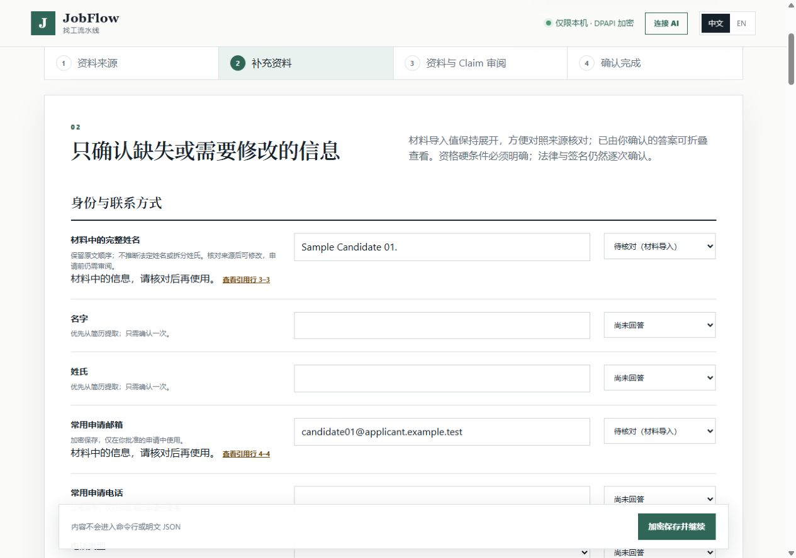
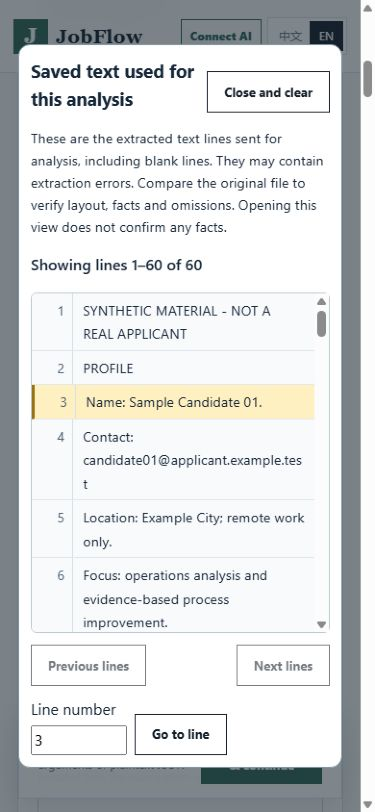

# Applicant identity and contact source review

Verified October 30, 2026. Source optimization only; no signed release,
deployment, real applicant data, model upgrade or external application action.

## Problem and resulting behavior

The earlier six-source replay preserved email hints but none of the full names.
The name splitter could not represent a Chinese or numeric synthetic display
name. Profile generation also rebuilt a familiar name from first/last fields,
dropping its middle part. Separately, scanning every document contact could
propose a reference or employer email as the applicant's address.

The new `profile_source_hints` module separates applicant attribution from the
existing whole-document privacy scan. It reads the exact saved analysis input,
not another extraction, and returns bounded hints with source/text hashes and
line coordinates. Broad privacy detection still includes third-party contacts.

- `candidate_display_name` is an optional, editable **Full name as written**
  question. There are now 40 fields, still 25 required answers. Existing states
  backfill it as unknown without changing historical ciphertext.
- Explicit English/Chinese name labels preserve their text and ordering.
  Familiar Latin header names can retain editable first/last hints. Ambiguous,
  single-token, mixed or numeric names are not forcibly split. The full value
  takes precedence during Profile generation, including its middle component.
- Contact hints must occur in the initial header, before a recognized body or
  reference section. Duplicate identical values count once; competing values
  remain unresolved. Website candidates also require a unique value per field.
- Imported answers are still `APPLICANT_PROVIDED_UNCONFIRMED`; the legacy
  answer-resolution status is separate from Profile approval. The UI says
  **Needs review (imported)** and keeps these fields expanded. Viewing a source,
  switching language or retaining a file never approves a Profile or Claim.
- Source links verify the current value and source/text hashes. Changed
  analysis disables stale links. Explicit re-analysis confirmation can rebind
  the same imported value; it cannot overwrite a different existing answer.
- Editing a field removes its old attribution. Changing an answer resets
  Profile review. Deleting a source clears matching unreviewed imported values;
  manually confirmed answers remain, with the old source association removed.

Pending values, provenance hashes and exact text stay in encrypted state.
Bootstrap exposes only the applicable coordinates, never the private value
hashes or transcript. Reading a quote uses the existing authenticated local
source-review endpoint, its integrity checks and response bounds.

## Evidence and failures retained

Nine integration contracts were frozen at `d3fd390` before implementation. The
baseline produced eight failures and four errors across methods/subtests. One
fixture assertion initially assumed an empty Claim list, although the shared
fixture already seeded two Claims; it now asserts exact preservation of that
baseline instead. No Claim or approval requirement was removed.

The related 114-test run had 113 passes and one legacy-fixture error: adding an
optional field made its generic answer helper supply a new display name during
a test intended to exercise an unknown name. That fixture now marks the new
field unknown too. The subsequent related run passed 116 tests in 74.439 seconds.
After the Chinese-heading fix, all 18 focused contracts passed in 10.288 seconds.
They include contradictory headers, references, bounds, old previews, manual
edits, deletion, reopening, stale coordinates and unchanged authorization.

| Same six exposed original synthetic sources | Prior measurement | First new replay | Corrected replay |
| --- | --- | --- | --- |
| Email matches its source | 6/6 | 4/6 | 6/6 |
| Full-name hint matches its source | 0/6 | 4/6 | 6/6 |
| Both fields have usable source coordinates | Not implemented | 4/6 | 6/6 |
| Original bytes and answers survive encrypted reopen | 6/6 | 6/6 | 6/6 |

The first new replay at `12b22cc` incorrectly stopped at the Chinese
personal-profile heading. Preserve [that observation](../evaluations/2026-10-30/profile-source-hints-replay-v1.json).
A separate failing contract was frozen at `922b5b7`; `f33bc55` recognizes that
personal-profile heading. The [second replay](../evaluations/2026-10-30/profile-source-hints-replay-v2.json)
uses the same six PDFs/image, pinned model responses and extraction modes:
two text PDFs, one regions PDF and three visual transcriptions. Actual Windows
DPAPI, original-byte checks, service reopening and source-line checks pass.
No new model request, approved Profile, Claim, application or external action
is created. The unapproved Profile builder retains all six names. Temporary
state is removed. The earlier 241/282 Claim-candidate measurement is unchanged.

The browser run also exposed loss of imported-source status during language
switching: the UI replaced answer objects with value-only drafts. The backend
was not approved, but the screen wrongly collapsed the fields as confirmed.
An actual locale-click regression was frozen failing at `44c2f2f`; `821df19`
preserves answer metadata and removes stale attribution for edited drafts. The
expanded transcript/browser suite passes 14 scenario groups, including both
languages, 1280/390 widths, editing and locale changes. Earlier full UI results
and failures are recorded separately from the final rerun in the receipt.

Assistant-operated local HTTP/DPAPI checks use an original three-page synthetic
PDF and its pinned response: retain it with zero selected Claims, inspect the
name at line 3, switch languages, inspect a narrow-screen quote, edit the name,
save and reload. The desktop UI is Chinese and mobile UI English. This is not
independent human acceptance, a new live model test or a real application.

Exact commits, logs, full-regression/CI status and package evidence belong in
[the delivery receipt](../evaluations/2026-10-30/profile-source-hints-v1.json).

## Run and verify

Use the existing README development setup and declared build/MCP/document test
extras. Start the local onboarding center with
`python -m jobops.cli onboarding-center`. Configure the existing Hermes or local
model route as usual. This feature introduces no dependency, provider or setting.
Upload a resume, review and retain the source, then open Missing details. Review
the field's cited lines and original pages before saving corrections and doing
the separate Profile review. Final submission remains a trusted user action.

Run the focused tests with `python -m unittest discover -s tests -p
"test_profile_source_hints*.py" -v`. Run `npm run test:e2e` for browser contracts
and existing UI integrations. For the fixed six-source DPAPI replay, use
`python scripts/measure-profile-hint-destinations.py --output reports/NEW-NAME.json`.
The script rejects an existing output and cannot load arbitrary applicant files
or call a provider. Outputs are measurements, not an automatic semantic pass.

## Limits and rollback

This deterministic module examines at most 80 physical lines and 16 nonempty
header rows. It is not identity recognition. Unsupported headings, unlabeled
single-token names, wrapped/ambiguous contacts, references embedded without a
recognizable boundary and extraction errors still require manual review.
Explicit name-label punctuation is retained verbatim. A supplied full name is
not proof of legal identity. Images still need original-page verification.

Legacy pending imports without bound attribution do not newly fill answers;
retain the source and enter the value manually or explicitly re-analyze it.
Previously stored/confirmed answers are not silently corrected. Segmented or
unavailable analysis snapshots cannot supply these traceable hints. No work
authorization, salary, availability, remote preference or other constraint is
automatically answered by this feature.

There is no database schema migration. Back up encrypted state and the matching
application before upgrade. Roll back with a reviewed revert and a matching
pre-upgrade encrypted backup, preserving the newer data separately. Older code
does not understand the new optional field/provenance and may expose additional
pending metadata; do not delete fields, relabel Profile versions or overwrite
historical observations to make a downgrade appear compatible.

Full 36-material semantic acceptance, held-out generalization, complete
non-Claim destinations, independent user acceptance, live ATS/mailbox flows,
trusted production signing and independent clean-Windows lifecycle testing
remain open. Source retention must not be added to Claim recall and described
as the same metric.
