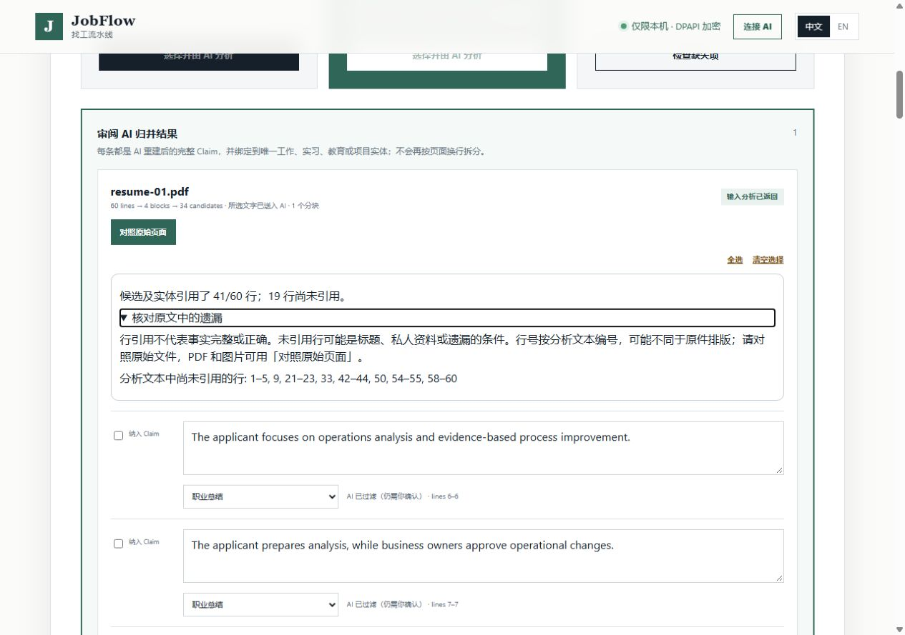

# Complete source-fact review and citation visibility - 29 October 2026

JobFlow has **not established the full-material acceptance target**. Reviewing all
282 authored facts and all 197 candidate outputs from six exposed development
files found 241 facts represented in Claim candidates: **85.46% of this fixed
source-fact denominator**. This is a coding-assistant review of candidate
representation, not independent semantic validation or whole-product recall.

The change makes omissions easier to inspect. It does not improve the model's
extraction in these observations: replayed candidate outputs are unchanged.

## Fixed evidence and decisions

The six files and original live observations come from the
[complete-material follow-up](complete-claims-2026-10-29.md). No source, gold fact,
model response or historical failed result was rewritten. The new review binds
each decision to source bytes, manifest/replay LF hashes, a candidate hash and
explicit source fact IDs. Every fact and every candidate remains in scope.

| Exposed development file | Facts represented / all source facts | Candidates reviewed |
| --- | --- | --- |
| English chronological PDF | 41 / 47 | 34 |
| Chinese chronological PDF | 40 / 47 | 33 |
| Mixed-language paired columns | 40 / 47 | 33 |
| English scanned PDF | 41 / 47 | 34 |
| Chinese scanned PDF | 39 / 47 | 30 |
| Mixed-language portfolio capture | 40 / 47 | 33 |
| Total | 241 / 282 | 197 |

Of 41 facts absent from candidates, 12 are identity/contact facts intentionally
excluded from the Claim channel. They remain in this denominator. The existing
Profile import can seed private facts after source confirmation; its completeness
on these six files was **not measured**. Claim absence therefore cannot establish
that those facts were lost from the whole product.

The other 29 omissions include remote-only location constraints, availability and
unknown work authorization, absence of underlying customer evidence, and the
need to verify references/credentials. Some files also lose the absence of
GPA/awards/licenses or the distinction between completed and proposed work.
These facts must find an appropriate reviewed destination; turning every missing
condition into a resume Claim would be incorrect.

The coding assistant marked all 197 retained candidates supported after inspecting
their wording, source, entity, dates, numeric values and responsibility boundary.
That is a review decision, **not evidence of zero possible errors**. The Chinese
scan's previously recorded transcription difference about submitting totals for
review remains noted as a qualitative paraphrase requiring independent review.
The English chronological project's blank organization metadata is also recorded;
the candidate names the project, but the entity display is incomplete.

## Product behavior

Previously, the preview could say `100% selected-content coverage` and `AI analysis
passed`. The percentage described input characters processed, not recovered facts.
It now says that selected text was sent to AI and that input analysis returned.

The host computes a separate citation summary from accepted candidates and entity
context. It counts nonempty analyzed-text lines once, reports uncited ranges,
rejects malformed/out-of-bounds coordinates, and limits the visible list to 40
ranges without reducing the total. Models cannot override this summary with a
claim of completeness. Oversize-line segmentation reports unavailable coordinates.
Legacy previews also explain that reliable line references are unavailable.

The expandable explanation is available in Chinese and English and works with the
keyboard. Line numbers refer to analyzed text, which can differ from original
page layout. PDFs/images retain **Compare original page**; TXT/DOCX users must open
the original file separately. This milestone does not add a numbered transcript
viewer or clickable jumps from gap ranges.

Line coverage is a navigation aid only. A candidate can cite a broad entity range
without representing every fact inside it. Even all lines cited leaves
`fact_completeness_verified=false` and `semantic_recall=null`. Uncited lines may
also be headings or private profile information. No omission is filled by rules,
no candidate is selected automatically, and approval/final-submit boundaries stay
unchanged.

## Verification and reproduction

- Eight citation-count contracts cover gaps, whole-document citations, empty
  candidates, coordinate errors, segmentation, range bounds and content-free output.
- Seven review-ledger contracts preserve denominators and evidence hashes and
  allow unsupported extras or unresolved facts to be recorded without false credit.
- The onboarding integration test derives counts on the host despite forged model
  metadata and preserves them through pending-state reload, leaving answers,
  approved facts and selection unchanged. The 75-test onboarding module passes.
- All 13 JavaScript/Edge suites pass, including seven new scenario groups for the
  bilingual citation UI, keyboard access, 1280/390 widths, legacy/invalid metadata,
  escaping and unchanged selection. The local `npm` command was unavailable;
  its exact package script target was run directly with Node.
- Same-output replay through the actual parser/DPAPI preview retains the same
  197 candidates. The original three invalid visual responses still fail with
  `VISUAL_RESPONSE_INVALID`; the three later recorded visual responses reach preview.
- Actual browser operation used the local HTTP service and Windows DPAPI with the
  pinned English PDF and recorded model response. Chinese desktop and English
  mobile views, keyboard expansion, original page 1 of 3, and reload were checked.
  All 34 candidates remained unselected, the page reported 41/60 cited lines and
  19 uncited lines, and no console error was observed. The owned server/state/tab
  were closed and removed. This is assistant-operated review, not independent
  human acceptance or a fresh live model call.

The [machine-readable receipt](../evaluations/2026-10-29/source-coverage-verification.json)
records exact replay/test/source hashes and the observed full-suite/CI status.
Do not substitute an earlier commit's hosted result for this branch.



The screenshot uses synthetic material with a recorded model response. The input
text and candidate counts are different measures from the fact table above.

```powershell
python scripts/check-complete-source-review.py --check evaluations/2026-10-29/complete-claims-source-review-summary.json
python -m unittest discover -s tests -p test_candidate_coverage.py -v
python -m unittest discover -s tests -p test_complete_source_review.py -v
node tests/onboarding_source_coverage_e2e.cjs
python tests/source_coverage_ui_server.py --stdio-control
```

The last command prints a local URL; enter `STOP` on stdin for cleanup. It accepts
no applicant path and makes no live provider calls. The full JavaScript command
is `npm run test:e2e`, whose direct equivalent is
`node scripts/run-javascript-e2e.cjs`. For a new complete replay, choose a fresh
output path using `scripts/replay-complete-claims.py`; original observations are
never overwritten. No additional package, model, account or configuration is needed.

## Remaining acceptance and rollback

Next, measure non-Claim facts through the Profile/constraint review destinations,
address the retained omissions and evaluate date/ownership paraphrases and
conflicting sources. Freeze a separate call budget before additional model runs.
The whole 36-file/1,716-fact evaluation, independently authored holdouts, >=95%
supported-fact recall and zero unflagged critical errors remain unestablished.
No accuracy gain, cost reduction or reduced user workload is claimed here.

The runtime change adds optional metadata to pending reviews. It has no database
migration or background task and does not rewrite saved Claims or approvals.
Rollback the source commit on an isolated branch and rebuild; retain encrypted
originals and user records. Older previews remain readable, but reverting the UI
also removes its clearer wording and citation notice. No deployment or release
is performed. Trusted production signing, an independent clean Windows machine,
live ATS/mailbox acceptance and independent-user testing remain outstanding.
