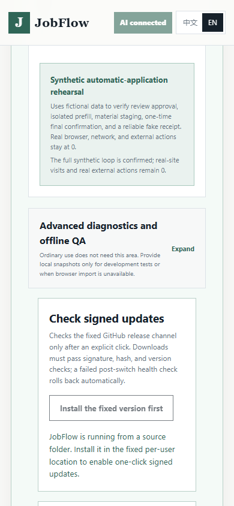

# User acceptance review — October 29, 2026

JobFlow's source preview can understand the fixed visual material, retain its
evidence, and rehearse a controlled application through a fake receipt. It is
not yet a signed, independently install-tested product with a verified live
application journey. This review found and repaired three UI defects that the
earlier passing service tests did not expose.

The operator was the coding assistant using the visible browser interface,
including source-page inspection, deliberate mistakes, reload and mobile
checks. This is synthetic user simulation, not an independent human study.
No real resume, mailbox, employer form or application was used.

## Version and evidence scope

- Default `main` was still `b5cf5e73ed0378374dfe0d97964ef1d3cd8455e0`
  when refreshed on October 29. These capabilities and fixes belong to the
  draft source stack, not a newly released desktop build.
- Baseline: draft #8 at `3e232d73275ee81e45ec8e81eb0bff708e6cf324`,
  incorporating #7 at `bf48283ce1632a0d4bc51fc80f72cebd454ec6b2`.
- This branch: `codex/jobflow-user-acceptance-20261029`, stacked on #8.
  The live session used the baseline backend; the UI repairs were exercised
  during the session and in the final related browser suites.
- [Sanitized observation and exact file hashes](../evaluations/2026-10-29/user-acceptance.json)
  retain synthetic statements, page/line evidence, request timings and limits.
  Local raw reports remain under ignored `reports/user-acceptance-2026-10-29/`;
  private paths and opaque secure references are excluded from the public receipt.

## What actually worked

| Journey | Observed result | Evidence level / limit |
| --- | --- | --- |
| Empty workspace → existing Hermes connection | Real connection and structured capability probes returned | Actual configured interface; no new account or Agent installation |
| Upload scanned/two-column/portfolio material → review | Three synthetic pages became 13 lines, four entities and ten initially unselected candidates | Actual model and production preview; one frozen PDF, not general accuracy |
| Check original → retain facts → reload | All three originals displayed; ten candidates retained in Windows DPAPI state, still `PENDING` and not approved for external use | Actual HTTP, browser and encryption; source confirmation is distinct from Claim approval |
| Select all without original confirmation | Blocked; select-all did not impersonate visual verification | Deliberate misuse through the UI |
| Finish onboarding with missing answers/reviews | Blocked; remained `IN_PROGRESS` with no application or approval | Correct gate; the operator did not invent missing applicant facts |
| Review saved job and supplied mail | Valid JD displayed, missing snapshot reported; manual EML association persisted on reload and could be undone | Real local storage with synthetic messages; no mailbox authentication or automatic matching claim |
| Review packet → approve → rehearse → final confirmation | Passed after the demo-specific repair; fake receipt shown, real external actions remained zero | Seeded synthetic application and fake AI; not a live employer receipt |
| Chinese/English, desktop/mobile, keyboard | Both languages and narrow screens checked; keyboard upload repaired and retested | Browser UI acceptance, not comprehensive assistive-technology certification |

The fixed material preserves six designated facts: 12 stores, 18% reporting
time reduction, 1,200 records, a $12,500 team budget, 24 team scenarios and six
applicant reports. The coding assistant compared all ten statements against
the original pages and observed no omission, numeric error, date reassignment
or team/applicant ownership change among those facts. This does not measure
performance on unseen resumes, establish calibrated bounding-box accuracy,
or substitute for the applicant's approval.

The live route was the existing `gpt-5.6-sol` / `openai-codex` through Hermes
commit `afe53708ee7400919ae3e17a6dde9b02629e5c87`. Four adapter requests
returned with zero tool calls: connection 4,453 ms; structured capability
10,625 ms; visual transcription 12,407 ms; material understanding 16,593 ms.
The two material requests total 29,000 ms. That is not end-to-end user time.
Token usage, provider-internal requests and billed cost are unknown. This
round did not rerun a paired old/new model benchmark; the separate
[October 28 comparison](material-preview-evaluation-2026-10-28.md) remains
historical evidence, not a new accuracy or speed gain.



The receipt in this screenshot is explicitly fictional. The source-install
notice below it is also intentional: this checkout is not an installed build.

## Defects reproduced and repaired

| Before | Repair | Verification |
| --- | --- | --- |
| The demo's approval button demanded a real Browser Companion, so a user could not enter the isolated rehearsal through the UI | Use the existing local queue-decision route only when `demo_mode`, `synthetic_only` and the seeded application identity all match; explain its scope in both languages | Actual click-through to fake receipt; new HTTP/DPAPI browser regression; ordinary companion confirmation suite still passes |
| After material analysis, the next-step card still told the user to upload material | Pending previews now lead to original-source review before the empty-source instruction | Live observation plus bilingual regression with no saved source |
| Tab skipped both upload controls because their native inputs were `display:none` | Keep the input visually hidden but keyboard focusable, with a visible wrapper focus outline | Real Tab interaction and assertions for both document and supporting-material inputs |

No approval policy, backend state transition, release gate, timeout or
final-submit boundary was relaxed. Demo approval does not pair an extension
or authorize a real application. Ordinary approval still requires the current
companion and follows its existing application-specific flow.

## Validation ledger

The formerly pending hosted matrices have now finished, with distinct results:

| Baseline | Hosted run | Python 3.11 / 3.12 / 3.13 | Source candidate job |
| --- | --- | --- | --- |
| #7 `bf48283` | [40851600301](https://github.com/ValerianXXX/JobFlow/actions/runs/40851600301) | 3.11/3.12 passed 1,184 regressions and nine browser suites; 3.13 exited before completion | Passed; 797 ms bootstrap |
| #8 `3e232d7` | [40851805710](https://github.com/ValerianXXX/JobFlow/actions/runs/40851805710) | Each passed 1,192 regressions and nine browser suites | Passed; 765 ms bootstrap |

In #7's Python 3.13 job `123372715234`, the log ends during
`test_scan_and_missing_page_never_become_successful_empty_text` with process
exit code 1, without a unittest failure summary or traceback. Its later
browser checks were skipped, not passed. The optional parser and its test are
byte-for-byte unchanged in #8, where the complete 3.13 run passed. The cause
of the earlier abrupt exit remains unresolved; a later pass is not a causal
repair. The optional Docling parser remains opt-in and was not used for the
real Hermes visual journey above.

Those matrices test the baseline commits, not the subsequent UI repairs.
The repairs passed these focused checks locally on Windows, Python 3.11.3
and Node 24.19.0:

- `test_real_profile_offline_application`: 33 passed in 594.594 seconds.
  Uses synthetic profiles, fake AI and saved official-page fixtures through
  the offline application pipeline; the filename does not mean real people
  or live employer submissions.
- `test_demo`, `test_workflow_gates`, `test_public_docs`: 20 passed.
- `onboarding_ui_e2e.cjs`: passed, including both new bilingual guidance and
  keyboard-focus assertions.
- `workbench_ui_e2e.cjs`: passed with real loopback HTTP and Windows DPAPI,
  desktop/mobile layouts, source integrity, EML link/reload/undo/clear and
  UI approval through a synthetic receipt. No external requests or page errors.
- `browser_companion_e2e.cjs`: passed the local Greenhouse, Lever, Workday,
  Ashby and SmartRecruiters fixtures, including approved fields, attachment,
  redraw rebinding and protected controls.
- `browser_companion_one_confirmation_e2e.cjs`: passed the normal approval
  path; one prefill, no duplicate execution, zero programmatic final submits.

The first companion invocation could not resolve Playwright in this worktree.
The rerun used the already installed pinned dependency from the sibling
checkout and passed; no dependency version or test assertion was changed.
An initial live-harness setup had no verified connection and the UI correctly
disabled analysis; the final run includes the real connection probe above.
Neither setup issue is hidden as a passing first attempt.

## Reproduction and configuration

Use the normal [source development setup](../README.md#development), existing
Hermes route and Windows DPAPI. The optional harness is for this synthetic
review only; it is not a product launcher or a user-profile migration.

```powershell
python -m unittest discover -s tests -p test_real_profile_offline_application.py
python -m unittest discover -s tests -p test_demo.py
python -m unittest discover -s tests -p test_workflow_gates.py
python -m unittest discover -s tests -p test_public_docs.py
node tests/onboarding_ui_e2e.cjs
node tests/workbench_ui_e2e.cjs
node tests/browser_companion_e2e.cjs
node tests/browser_companion_one_confirmation_e2e.cjs
```

For an intentionally live, quota-consuming reproduction:

```powershell
python scripts/user-acceptance-server.py --live-hermes --output reports/user-acceptance-new.json
```

The harness requires the existing WSL Ubuntu Hermes route used by the
material evaluator. It creates an empty disposable workspace with real DPAPI,
verifies the real connection, accepts only the SHA-256-checked synthetic PDF
at `evaluations/2026-10-27/visual-hermes-repaired-2026-10-27.synthetic.pdf`,
and allows at most six adapter requests including setup. It seeds no completed
profile, application, approval or AI output. Open the loopback URL it prints,
upload that fixture, try the missing-confirmation case, inspect all three
original pages, retain the candidates, reload and try the incomplete-profile
gate. Use synthetic values only. This temporarily enables visual processing
inside the harness; it does not change the user's Agent configuration.

Create the output's matching `.stop` file to end it gracefully, for example
`New-Item reports/user-acceptance-new.stop -ItemType File`. The harness writes
a fresh receipt and removes its temporary encrypted state. Never overwrite
an earlier observation or publish a raw receipt without reviewing its fields.
No new production environment variable or dependency is introduced.

## Remaining acceptance and recovery

1. **Editable resume:** scanned PDFs can now be understood and retained, but
   layout-preserving resume tailoring still requires an approved editable
   DOCX master. The live UI explicitly requested it. PDF import alone is not
   a completed tailored-resume workflow.
2. **Live application:** the fixed synthetic ATS pages establish contract
   behavior. They do not prove a current employer's login, CAPTCHA, dynamic
   form, file acceptance, final review or employer receipt. Any future live
   acceptance remains user-present, with the user performing final Submit.
3. **Mail tracking:** local EML evidence and reversible association work.
   Authenticated mailbox ingestion, continuous status recovery and automatic
   changes to protected application execution state are not shipped.
4. **Distribution:** the owner has confirmed no trusted production signing
   workflow or independent clean Windows machine/VM is available. Signed
   installation, upgrade, data-preservation and rollback acceptance remain
   blocked. Full CI and an unsigned development run do not clear them.
5. **Optional-parser stability:** the earlier #7 Python 3.13 abrupt test-process
   exit has no diagnosed cause. Keep the failed run visible even though the
   unchanged parser passed in #8; no stability improvement is claimed here.
6. **Product outcome:** no hiring outcome, independent novice completion
   rate, broad resume accuracy, or measured cost benefit has been established.

This change needs no database migration, production deployment, extension
store update or release. The temporary test state was removed. The UI patch
can be reverted independently while retaining encrypted data; preserve a
database/private-state backup and close the application before any future
source-version rollback. Reverting it restores the three known UI defects.
The older signing and independent Windows blockers remain unchanged.
