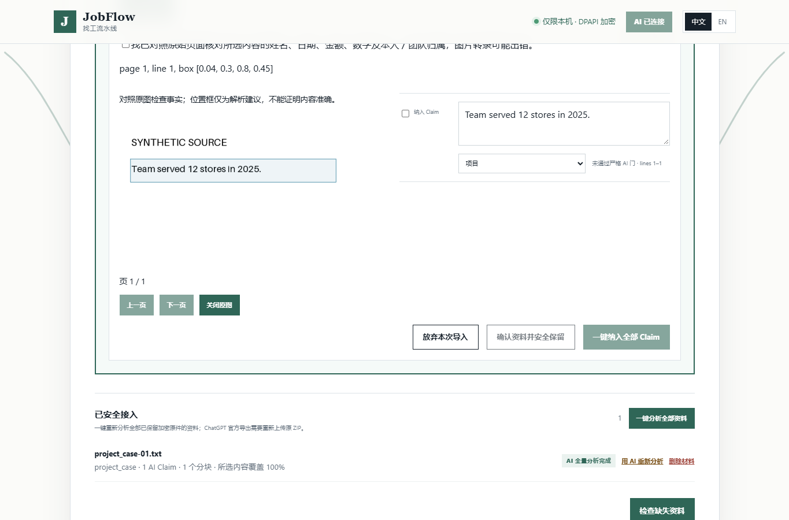
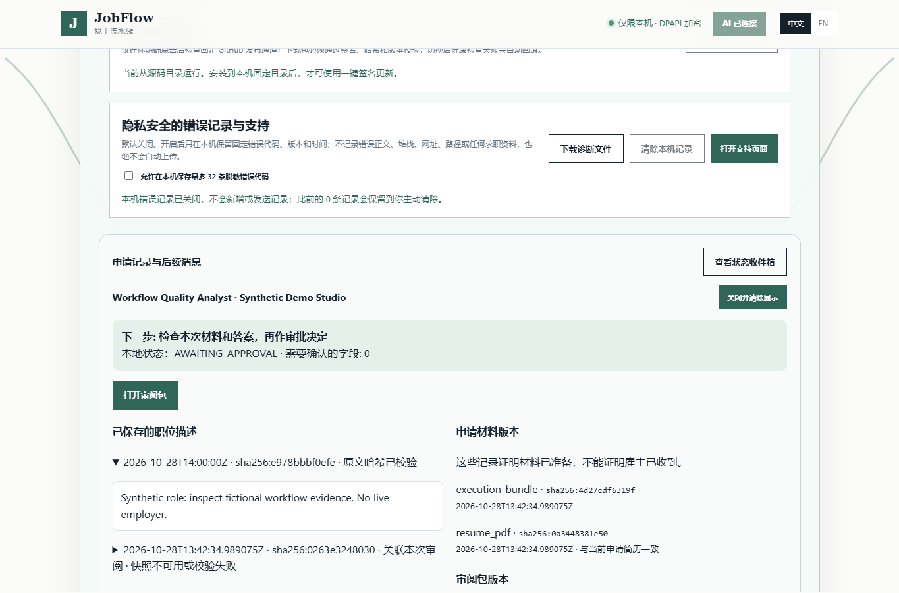
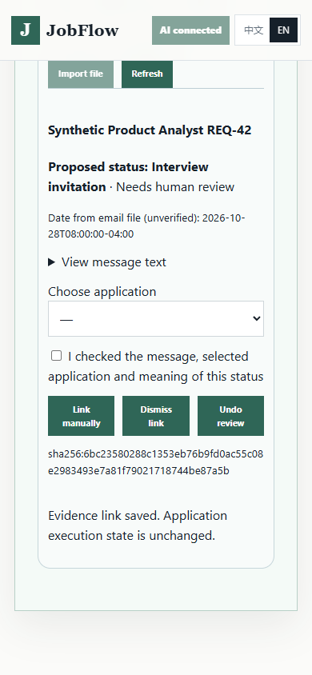

# JobFlow：申请工作区与证据审阅预览

核验日期：**2026-10-28**。这是源码预览，基于发布修复 PR #5 和材料理解 PR #6；不是已发布的 Windows 安装包。仅使用本地合成资料、虚构邮件和隔离数据库验证，没有读取真实邮箱或简历。

## 本次改变

- **职位详情**：从待审批或最近申请进入，查看已保存的 JD、完整性校验、材料哈希与版本、审阅包版本、流程记录和下一步。新快照按规范 UTF-8/LF 字节保存；旧 Windows CRLF 快照仅在换行规范化后哈希完全相同时通过，并标明校验方式。文件缺失或正文改动时明确显示不可用，不重新抓取替代原证据。材料已准备不等于雇主已收到；`SUBMISSION_UNKNOWN` 仍提示核对雇主端结果，不能自动重试。
- **原始页面对照**：在材料审阅中查看已加密保留的 PDF/PNG/JPEG，支持翻页和区域框。只在当前本地会话中解密、渲染，不写明文图片到项目。框只是解析建议，不能证明事实或本人贡献；原有逐条 Claim 和原文核对门槛继续适用。
- **状态收件箱**：用户主动选择一个 EML 文件，保存加密原件、规范化内容和审阅历史。区分收到申请、拒绝、面试邀请、无法确定；人工选择申请并确认关联，可忽略、撤销。重新打开可恢复记录；旧页面的过期审阅提交会被拒绝。若导入中途保存失败，只回滚本次新建的证据，不删除已有或去重复用的资料；查看时还会重新核对消息与审阅记录的内容哈希。没有邮箱 OAuth、自动读信、发信或申请执行状态修改。
- **Hermes 只读入口**：三个 stdio MCP 工具提供汇总、待核对申请 ID 和单个申请状态。实现使用只读 SQLite 连接，不初始化私人资料服务，不返回简历、姓名、公司、邮件、路径或 secure-ref。没有审批、填写、上传或提交工具。
- **可选本地解析**：Docling Native PDF Pipeline 提供文本与页面坐标，保留原有默认提取器。明确选择后失败即停止，不自动切换云端。它不是 OCR，也不是完整 Docling 布局模型。

本轮没有添加新的浏览器 Agent 框架，没有更换生产模型，没有重装 OpenClaw。还修正了原有窄屏刷新按钮溢出、切换语言后的收件箱提示，以及操作 Skill 中已失效的 CLI 路径。

## 参考的产品源码与取舍

以下均在核验日读取官方仓库源码与许可证，记录不可变提交；**未复制上游产品源代码**。

| 来源 | 读取内容 | 用于 JobFlow 的设计判断 |
|---|---|---|
| [Reactive Resume，MIT](https://github.com/reactive-resume/reactive-resume/tree/d644b9963290ae71cd8cbc50f36063ef2036fcc4) | `packages/api/src/features/resume/service.ts`、`version-history.ts`：更新冲突检查和独立版本历史 | 复用已有材料/审阅包版本；邮件关联使用最新 review-ref 拒绝过期页面覆盖，不重建编辑器或简历存储 |
| [Docling 2.144.0，MIT](https://github.com/docling-project/docling/tree/a857fd208ccd61fb4a5d230384554ce778f216df) | `docling/document_converter.py`、Native PDF 选项与 provenance | 独立可选适配器、页数完整性验证、位置证据；评测未显示提取质量收益，保持默认路径 |
| [Stagehand，MIT](https://github.com/browserbase/stagehand/tree/737480022acbf5ec3450885f120fc33ee561a9b4) | `packages/extension/services/observeService.ts`：观察页面、生成候选、解析真实元素、丢弃无法定位的结果 | JobFlow 已有观察/执行分离、当前页面重绑定、逐次授权与禁止最终提交的机制；保留并回归验证，不引入重复执行器 |
| [Hermes 源码](https://github.com/NousResearch/hermes-agent/tree/bf0203a794a07aac3ff764972ab9087baa4e4f4e) | 调研版本 v0.22.5 的 MCP 安全实现与[官方 MCP 文档](https://hermes-agent.nousresearch.com/docs/user-guide/features/mcp) | 使用显式 stdio 命令和仅三个只读工具；实测使用本机已有 v0.16.0，不把新版文档当成本机能力证明 |
| [OpenResume](https://github.com/xitanggg/open-resume/blob/main/LICENSE) | 当前许可证为 AGPL-3.0 | 不按 MIT 项目处理，也不把源码复制到本项目 |

MCP 使用[官方 Python SDK 2.3.0](https://pypi.org/project/mcp/2.3.0/)实际的协商与结构化工具结果实现；本轮验证 [2026-07-28 规范](https://modelcontextprotocol.io/specification/2026-07-28)及旧版客户端路径。Docling Native 的边界依据[官方选项文档](https://docling-project.github.io/docling/reference/pipeline_options/)：没有 OCR、布局或表格模型，不能将它宣传成扫描件理解升级。

## 可复现对照结果

完整逐项记录见 [evaluation-workbench-2026-10-28.json](evaluation-workbench-2026-10-28.json)，生成器为 `tests/workbench_fixtures.py`，采集器为 `scripts/evaluate-workbench.py`。原始素材全部由代码合成；没有外部用户样本。

材料样本：10 份单栏文本 PDF、10 份内容流交错的双栏文本 PDF、5 份扫描 PDF、5 张作品集图片。既有路径关闭视觉功能；两组都通过相同的文档质量预检。比较覆盖“提取文本”这一阶段，没有运行后续模型实体归并和 Claim 生成。

| 指标 | 原有文本路径 | Docling Native 候选 |
|---|---:|---:|
| 材料数 | 30 | 30 |
| 未能提取、明确停止 | 10 | 10 |
| 指定数字未出现 | 20 | 20 |
| 完整事实文本未出现 | 30 | 30 |
| 返回的来源区域 | 0 | 120 |
| 全部样本中位耗时（单机一次测量） | 18 ms | 2,963 ms |
| 模型调用 / 模型费用 | 0 / $0 | 0 / $0 |

缺失的数字和事实文本均来自未提取的扫描件/图片。其余 20 份文本 PDF 两条路径都保留了指定文本与数字，**没有证明候选降低遗漏或数字错误**。完整事实字符串出现不证明实体归属、双栏阅读顺序、团队/个人贡献或生成 Claim 正确；这些语义指标未测。120 个位置框也未做人工标注定位精度评测。费用只计模型调用，不包含计算设备、电力或维护成本。更早的小规模真实视觉模型试验仍保留在[原记录](visual-materials-and-status-tracking.md)，不能与本轮当作同一实验比较。

邮件样本：60 个 EML，来自 10 种中英文模板的变体，覆盖普通文本、HTML、伪造认证头、冲突状态与无关内容。这不是 60 种独立业务场景，也不能代表生产分布。

| 指标 | 本轮结果 |
|---|---|
| 状态提议与模板标签不符 | 0 / 60 |
| 错误自动关联 | 0 / 60 |
| 必须人工核对 | 60 / 60 |
| 已认证邮箱的匹配召回率 | 未测；没有邮箱连接器 |
| 真正申请状态回收 / 雇主确认 | 未测；本轮只实现文件证据与人工关联 |

“零错误自动关联”来自所有本地 EML 都不被认证，而不是自动匹配准确率已达标。`Authentication-Results`、发件人和邮件 Date 均可伪造；日期显示为未验证文件头时间。否定句、转发/引用上下文、多线程邮件及更广泛语言尚需扩充标注数据，用户应核对状态提议。

## 验证分层

| 层级 | 已验证范围 |
|---|---|
| 合成/单元 | 快照哈希/路径拒绝、私密事件载荷不展示、EML 限额与 HTML 不执行、重复导入、关联/撤销、过期审阅、页图哈希/页数、会话/Origin 防护；本地解析实际子进程及失败不得云端回退 |
| SDK 合同与真实传输 | 官方 MCP SDK 2.3.0 通过真实 stdio 子进程调用三个工具；auto 协商 2026-07-28，legacy 协商 2025-11-25；不存在提交工具，SQL 写入被拒绝 |
| 现有 Hermes 客户端 | 本机 Hermes v0.16.0（报告 upstream `afe53708`）、Python 3.11.15、客户端 MCP SDK 1.26.0；真实 Hermes MCP 连接器协商 2025-11-25 并调用三个工具成功；使用临时 HERMES_HOME 与合成数据库，0 模型调用、0 用户配置修改 |
| 实际本地 UI | Windows DPAPI + 真实 loopback HTTP + Edge；中英文、1365×900 桌面与 390×844 窄屏、原图显示/关闭、快照可用/缺失、未勾选拦截、关联后刷新、撤销、关闭清除、演示禁用导入、外部请求为 0 |
| 尚未覆盖 | Hermes 对话中由模型自主选用工具；真实邮箱授权/收信/身份验证；真实雇主闭环；更多材料的语义与定位评测；签名安装包及干净 Windows 安装/升级/回滚 |

浏览器自动化在 `tests/workbench_ui_e2e.cjs`；合成候选刻意没有 AI 完整性证明，所以界面中的确认材料按钮仍被禁用。截图不是一次成功的模型分析。







## Run and configure

完整开发检查安装 `.[build,mcp,document]`；普通源码使用仍可只安装 `.[build]`。从已准备的源码环境启动 `python -m jobops.cli onboarding-center`，打开待审批申请的“职位详情”，或“申请记录与后续消息 → 查看状态收件箱”。演示入口仍是 `python -m jobops.cli demo`，演示禁止用户文件导入。

可选本地文本解析：

```powershell
.\.venv\Scripts\python.exe -m pip install -e ".[document]"
$env:JOBFLOW_DOCUMENT_PARSER = "docling_native"
.\.venv\Scripts\python.exe -m jobops.cli onboarding-center
```

限制为 16 MiB、6 页、有文本层的 PDF，60 秒子进程上限；关闭远程服务、外部插件和图片模型。取消该进程环境变量即恢复默认提取。`.env.example` 不会自动加载。此解析步骤本身不调用模型，但随后的 Claim 分析仍进入用户已配置的 AI 路径，可能使用云端；不能宣称整个流程都在本地。

原图查看支持不超过 16 MiB/60 页的 PDF，或单帧 PNG/JPEG；单页像素和返回数据量也有限制。超限时停止内嵌预览，用户应使用原文件核对，不跳过事实确认。EML 上限为 2 MiB、50 个 MIME 部分、50,000 字符；收件箱最多 1,000 条，不加载远程图片、附件、脚本或链接。

只读 MCP：

```powershell
.\.venv\Scripts\python.exe -m pip install -e ".[mcp]"
.\.venv\Scripts\python.exe -m jobops.mcp_server --project 'C:\path\to\JobFlow'
```

该进程等待客户端在 stdin/stdout 上发送 MCP 消息，没有 HTTP 地址。先通过本地 UI 初始化项目。需在 Hermes 中使用时，用户可以将以下配置合入自己的配置；本轮没有替用户修改该文件：

```yaml
mcp_servers:
  jobflow:
    command: 'C:\path\to\JobFlow\.venv\Scripts\python.exe'
    args: ['-m', 'jobops.mcp_server', '--project', 'C:\path\to\JobFlow']
    tools:
      include: [get_readiness, list_pending_reviews, get_application_summary]
```

WSL Hermes 应把 command 改为相应 `/mnt/c/.../python.exe`；传给 Windows Python 的 `--project` 仍使用 Windows 路径。MCP 环境不需要模型密钥。工具结果只含流程元数据，但仍会进入调用它的 Agent 上下文；是否发送给模型由该 Agent 的配置决定。

重现采集和重点验证：

```powershell
.\.venv\Scripts\python.exe scripts/evaluate-workbench.py
.\.venv\Scripts\python.exe -m unittest discover -s tests -p test_workbench.py
.\.venv\Scripts\python.exe -m unittest discover -s tests -p test_jobflow_mcp.py
.\.venv\Scripts\python.exe -m unittest discover -s tests -p test_local_document_parser.py
node tests/workbench_ui_e2e.cjs
```

报告写入忽略的 `reports/`，完整测试仍用 `python -m unittest discover -s tests -v` 和 `npm run test:e2e`。`scripts/probe-hermes-mcp.py` 是单独的开发探针：使用已安装 Hermes 的 Python，通过 `--hermes-root` 指向其源目录，stdin 传入合成 JobFlow stdio 配置（`command`、`args`、`env`）。它创建临时 Hermes 配置目录，并要求数据库只有一条 `SUBMISSION_UNKNOWN` 合成申请；不会连接现有账户。它依赖 Hermes 内部客户端接口，不是应用运行依赖或通用版本兼容承诺。

## 发布、数据与回滚

没有数据库迁移、生产部署、正式 Release 或扩展商店更新。新增邮件原件使用已有私密引用表与 DPAPI，审阅变更追加新加密版本；未改写申请状态机、审批状态或历史事实。当前容量上限不会自动删除旧证据。

回滚时关闭本地程序，保留原有加密资料目录及数据库备份，再切回上一个已审阅源码版本；不要将真实资料复制进 Git。旧版本可能不显示新收件箱/来源坐标，保留数据待重新升级。仅关闭 `JOBFLOW_DOCUMENT_PARSER` 就能停止候选解析；移除自己添加的 Hermes MCP 条目并重启客户端即可停止工具接入，不需要重装任何 Agent。没有生产迁移回退脚本要执行。

原发布阻塞继续保留：源版本 0.7.0 对应扩展 0.9.2，稳定桌面 0.6.0 仍不兼容该商店扩展；历史还有一项不同作者身份待处理，NOREPLY_ONLY 未被放宽；可信生产签名和干净 Windows 现场验收未完成。原文内容边界检查通过不等于身份或发布授权通过。详见[兼容矩阵](compatibility.md)和[发布整改记录](modernization-2026-10-27.md)。
